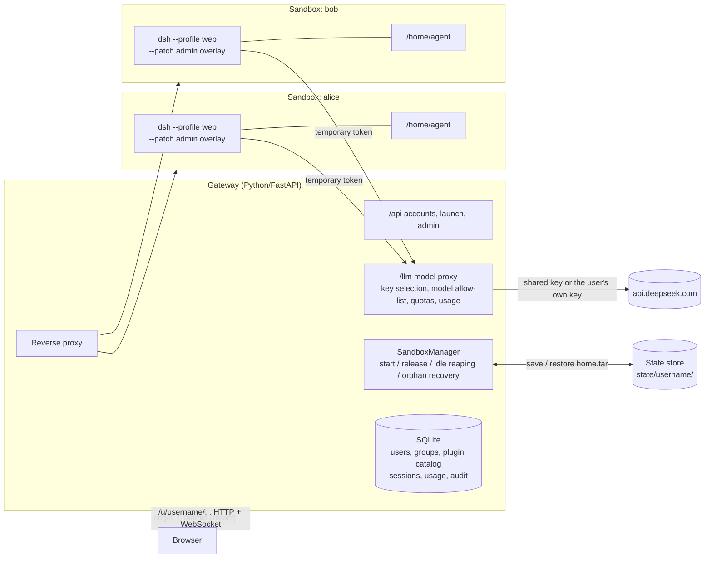

# dsh-cloud-sandbox

English | [中文](README.zh.md)

Gives every account its own **workspace**: an isolated sandbox running a complete [DeepSeek Harness](https://github.com/deepseek-ai/deepseek-harness) (dsh) Web. A gateway provides sign-in, account settings, and an admin console.

> **Read before launch:** user data is currently saved as a tar snapshot when a workspace goes to sleep. Before production, switch to [one persistent volume per user](#before-launch-one-persistent-volume-per-user).

- **Accounts**: administrators create accounts; users sign in with a username and password. Sessions are stored on the server and can be revoked.
- **Workspaces**: users never see a machine. After sign-in, a loading page of a few seconds leads straight into dsh, and conversations, files, memory, and the plugins they installed are always there. When idle, on sign-out, or after the maximum lifetime, the workspace is saved and **goes to sleep** (the sandbox is destroyed and its resources released); the next visit restores it exactly as it was.
- **Admin console**: manage users and groups; assign default plugins, MCP servers, and config patches per group or per user; set resources, allowed models, and daily quotas; view usage and the audit log.
- **Model keys**: the team's shared key and users' own keys stay on the gateway (user keys encrypted at rest) and never enter a sandbox.

dsh itself is unmodified: sandboxes run the official `@deepseek-ai/dsh` from npm. The sign-in page, loading page, account settings, and admin console are written in React and reuse dsh Web's design tokens (colors, radii, fonts, dark mode), so they look like dsh.

> Status: proof of concept. The Docker backend is verified end to end (sign-in, loading page, account settings, admin console, plugin and MCP provisioning, conversations, save on sign-out, sleep and resume, restart, orphan recovery). The E2B backend is implemented but **not verified with a real key**.

## Contents

- [Architecture](#architecture)
- [Project layout](#project-layout)
- [Requirements](#requirements)
- [Getting started](#getting-started)
- [Using it](#using-it)
- [Admin console](#admin-console)
- [Images: different software per group](#images-different-software-per-group)
- [Workspace browser: watch and take over the agent's browser](#workspace-browser-watch-and-take-over-the-agents-browser)
- [Provisioning plugins, MCP servers, and config patches](#provisioning-plugins-mcp-servers-and-config-patches)
- [Where user data lives](#where-user-data-lives)
- [Sandbox lifecycle](#sandbox-lifecycle)
- [Request flows](#request-flows)
- [Security model](#security-model)
- [Configuration](#configuration)
- [E2B backend](#e2b-backend-unverified)
- [Adding another sandbox backend](#adding-another-sandbox-backend)
- [Development and tests](#development-and-tests)
- [Troubleshooting](#troubleshooting)
- [Known limitations and launch to-dos](#known-limitations-and-launch-to-dos)
- [Before launch: one persistent volume per user](#before-launch-one-persistent-volume-per-user)

## Architecture



The whole system sits one layer outside dsh rather than being a dsh plugin: dsh's filesystem and process services are shared by the whole process, so a plugin cannot give each user a separate sandbox. Each user therefore runs their own dsh process, and the gateway orchestrates their lifecycles.

The gateway reverse-proxies dsh as required by dsh's guide [Publish the Web UI behind a reverse proxy](https://github.com/deepseek-ai/deepseek-harness/blob/master/docs/user/guide/public-deployments.md):

| dsh requirement | What the gateway does |
|---|---|
| Preserve the browser's Host | HTTP and WebSocket both forward the browser's Host; `--trusted-host` is the hostname of `GATEWAY_PUBLIC_URL` (dsh trusts loopback addresses by default) |
| Strip the mount prefix | `/u/<user>/api/x` is forwarded as `/api/x` |
| Forward WebSocket upgrades | Relayed both ways; connections are counted to decide idleness |
| Scope cookies to the mount | dsh's `Set-Cookie: Path=/` is rewritten to `Path=/u/<user>/` |
| Exchange the launch token for a cookie | On first visit the browser is redirected to the `?token=` URL dsh printed, and dsh sets its own session cookie |

## Project layout

```
dsh-cloud-sandbox/
├── README.md / README.zh.md
├── sandbox-image/                 Workspace images
│   ├── build.sh                   Builds the base image, then every team image in variants/ FROM it
│   ├── base/                      Base image (also the default image)
│   │   ├── Dockerfile             node:22 + dsh + pnpm + Chromium + LibreOffice + python3-venv + CJK fonts, user agent, compatibility labels
│   │   ├── entrypoint.sh          Install MCP packages → start the browser hub and dsh (with the admin overlay) → install default plugins in the background; forwards stop signals to both
│   │   ├── browser-hub/           Workspace browser hub (Chromium lifecycle, the agent's CDP proxy, the user's live view)
│   │   ├── workspace-browser/     dsh bundle + right-sidebar plugin "Workspace browser"
│   │   └── provision.py           Installs default plugins and MCP packages once per user, from /etc/dsh-cloud/policy.json
│   └── variants/
│       └── data-science/Dockerfile Example team image: the base plus numpy, pandas, scipy, matplotlib, scikit-learn
├── web/                           Sign-in, loading page, account settings, admin console (React + Vite + TypeScript)
│   ├── src/theme/                 Design tokens and fonts copied from dsh's ui-theme
│   ├── src/pages/Login.tsx        Sign-in page
│   ├── public/dsh-cloud-overlay.js Injected into dsh Web pages: account entries in dsh's More menu, account panel, sign-out, and the "asleep" cover
│   ├── src/sandbox.ts             Workspace status polling and the start/save progress model
│   ├── src/pages/Launch.tsx       Loading page: wakes the workspace, thin progress bar, enters dsh when ready
│   ├── src/pages/Account.tsx      Account settings: API key, usage, preinstalled plugins, password (embeddable as a panel in dsh)
│   ├── src/pages/Admin.tsx        Admin shell, overview, active workspaces, audit log
│   └── src/pages/admin/           Users, groups, plugins & MCP; offers to restart affected workspaces after saving
└── gateway/                       Gateway (Python)
    ├── run.sh                     Start script: loads .env, starts uvicorn
    ├── .env.example               Configuration template
    ├── pyproject.toml / uv.lock
    ├── dsh_gateway/
    │   ├── app.py                 Routes: /u/<user>/ proxy, /llm model proxy, web pages
    │   ├── api.py                 /api: sign-in, account, workspace status, admin
    │   ├── db.py                  SQLite: users, groups, plugin catalog, sessions, usage, audit
    │   ├── auth.py                Password hashing (scrypt), session tokens, API key encryption
    │   ├── policy.py              Groups and plugin assignments → sandbox resources, policy.json, overlay
    │   ├── gateway.py             Shared state; creates the default group and administrator on first start
    │   ├── usage.py               Token accounting from model responses (including streams)
    │   ├── proxy.py               HTTP / WebSocket forwarding, cookie and redirect rewriting, overlay injection
    │   ├── manager.py             One sandbox per user: start, release, idle reaping, orphan recovery
    │   ├── store.py               Per-user snapshot store (local directory; replaceable by object storage)
    │   ├── config.py              Environment configuration
    │   └── backends/
    │       ├── base.py            SandboxBackend interface
    │       ├── docker_backend.py  Docker implementation (verified)
    │       └── e2b_backend.py     E2B implementation (unverified)
    └── tests/                     Unit tests (no Docker needed)
```

## Requirements

| Dependency | Notes |
|---|---|
| Docker | OrbStack or Docker Desktop on macOS; for Linux see [Troubleshooting](#troubleshooting) |
| [uv](https://docs.astral.sh/uv/) | Manages the gateway's Python environment, Python ≥ 3.11 |
| Node.js ≥ 22 + pnpm | Builds the web UI |
| DeepSeek API key | From [platform.deepseek.com](https://platform.deepseek.com); optional if every user sets their own key in account settings |

## Getting started

### 1. Clone

```sh
git clone https://github.com/HanszZ16/dsh-cloud-sandbox.git
cd dsh-cloud-sandbox
```

### 2. Build the workspace images

```sh
sandbox-image/build.sh          # builds dsh-sandbox:dev (the default image) and dsh-sandbox-data-science:dev
```

For the default image only: `docker build -t dsh-sandbox:dev sandbox-image/base`.

On unreliable networks, point apt at a nearby Debian mirror and send npm through a local proxy (the arguments apply only to the build and are not stored in the image). Replace `7897` with your proxy's port:

```sh
BUILD_ARGS="--build-arg APT_MIRROR=mirrors.ustc.edu.cn \
  --build-arg http_proxy=http://host.docker.internal:7897 \
  --build-arg https_proxy=http://host.docker.internal:7897" \
  sandbox-image/build.sh
```

To use another dsh version, add `--build-arg DSH_VERSION=<version>` (default `0.2.1-rc.2`). The base image is about 2 GB (mostly Chromium and LibreOffice); a team image adds only what it installs.

### 3. Build the web UI

```sh
cd web
pnpm install
pnpm build          # writes web/dist, which the gateway serves
cd ..
```

### 4. Configure the gateway

```sh
cd gateway
cp .env.example .env
```

Edit `.env` and set at least:

```sh
GATEWAY_SECRET_KEY=<a long random string>   # python3 -c "import secrets;print(secrets.token_urlsafe(32))"
GATEWAY_ADMIN_PASSWORD=<initial admin password>  # creates the admin account on first start
DEEPSEEK_API_KEY=sk-...                     # team-shared key, optional
```

`GATEWAY_SECRET_KEY` encrypts the API keys users save. **Do not change it once set**, or saved user keys can no longer be decrypted (users would have to enter them again). `.env` is excluded by `.gitignore`.

### 5. Start the gateway

```sh
./run.sh
```

`run.sh` loads `.env` on every start, and its values override variables of the same name in your shell. **Restart the gateway after editing `.env`.** A successful start logs:

```
INFO dsh_gateway: set administrator 'admin' from GATEWAY_ADMIN_PASSWORD   (first start only)
INFO:     Uvicorn running on http://127.0.0.1:8000 (Press CTRL+C to quit)
```

### 6. Verify

1. Open http://localhost:8000 and sign in as `admin` with `GATEWAY_ADMIN_PASSWORD`;
2. In the workspace, open **More** at the bottom of the left sidebar → **管理后台 (Admin console) → Users**, and create a regular user;
3. Sign out and sign in as the new user: the loading page shows "preparing your workspace" and enters dsh after a few seconds;
4. On first entry dsh shows a preview notice; click Continue. When asked for a workspace directory, click **Open** (that is `/home/agent`);
5. Send a message. "Model requests today" on the admin **Overview** goes up.

### Upgrading from the earlier version

Data from the earlier version (sign-in by username only) is still in `gateway/state/<username>/`. Create an account with **the same username** in the admin console, and that user's data is restored on sign-in. `GATEWAY_LOGIN_PASSWORD` is no longer used.

## Using it

The user-facing UI never mentions sandboxes, containers, starting, or releasing: there is only the **workspace**, which is either active or asleep. (The UI copy is in Chinese; the quoted labels below are translations.)

| Page / action | Behavior |
|---|---|
| `/login` | Sign-in page. Accounts are created by administrators |
| `/` (loading page) | Where sign-in lands: wakes the workspace with a thin progress bar ("preparing your workspace" / "restoring your workspace") and enters dsh when ready. If it cannot open, it shows only "your workspace can't be opened right now" and a retry button; the raw error is shown to administrators only |
| **More** menu at the bottom of dsh's left sidebar | The gateway adds to dsh's own menu: the signed-in user at the top, **Account settings** (a panel over the current page, without leaving the workspace), **Admin console** (administrators only), and **Sign out** at the bottom. dsh's own Sign in item is relabelled **DeepSeek Sign in** (signing in to a DeepSeek account, distinct from the workspace account) |
| Account settings (`/account`) | API key, today's usage, plugins preinstalled by the team, password |
| Sign out | Saves the workspace (with progress), signs out, and returns to the sign-in page |
| Workspace goes to sleep while the page is open | The page is covered by "your workspace is asleep; your files, conversations, and settings are saved", with a **Resume workspace** button that returns to the loading page. The page checks every 10 seconds and when the tab becomes visible |
| Admin restarts the workspace while the page is open | Usually done in seconds; dsh reconnects by itself without a reload (dsh's signing key lives in the user's home, so the old cookie stays valid after a restart). If a check lands mid-restart, the page shows "updating your workspace" and comes back automatically |
| Closing the browser | The workspace stays active and is saved and put to sleep after the group's idle timeout (default 15 minutes) |
| A stale page sends requests after sleep | The gateway answers 503 and does not wake the workspace; only opening a page (the loading page) wakes it |

Stopping the gateway (`Ctrl+C`) saves every active workspace and puts it to sleep, waiting at most 10 seconds for browser connections to close.

## Admin console

Only administrators can open `/admin`; every change is recorded in the audit log.

| Page | Function |
|---|---|
| Overview | Users, active workspaces, today's requests and tokens, a 14-day request chart |
| Users | Create, edit (display name, role, group, disable, reset password, per-user plugins), delete (optionally with the user's data); see each user's workspace status and today's usage. Disabling a user or resetting their password ends their sessions immediately |
| Groups | Every user belongs to one group. A group sets: image, memory and CPU limits, idle sleep timeout, maximum lifetime, whether the shared key may be used, daily request limit, allowed models, default plugins |
| Plugins & MCP | Maintains the plugin catalog (three kinds, see [provisioning](#provisioning-plugins-mcp-servers-and-config-patches)), which groups and users are then assigned from |
| Images | Registers team images after checking they exist and match the default image; groups choose their image from here (see [Images](#images-different-software-per-group)) |
| Active workspaces | Shows status (active / resuming / saving); restart one or put it to sleep |
| Audit log | Sign-ins, sign-outs, and account and configuration changes |

Changes to groups, plugins, and user assignments apply the **next time a workspace starts**. Editors say so; after saving, if affected users have active workspaces, a dialog lists them and offers **Restart now** (save, then start with the new configuration, usually within seconds; their running tasks are interrupted and open pages reconnect by themselves). The Active workspaces page can also restart a single user or put their workspace to sleep, and lists workspaces that are resuming or saving. The admin console is for operators, so it keeps technical details such as sandbox ids, uptime, and connection counts.

Safeguards: at least one enabled administrator must remain; you cannot delete yourself; the default group cannot be deleted, and a group with users cannot be deleted.

## Images: different software per group

A workspace's **system software** comes from its image; **user data** (conversations, files, memory, plugins, venvs) comes from the user's own `/home/agent`. The two are combined at start, so changing a group's image only changes which software is installed, and users' data stays as it was.

| Need | Where it goes |
|---|---|
| System software everyone needs (Chromium, LibreOffice, fonts) | The base image, `sandbox-image/base` |
| System software or large libraries one team needs | A team image, `sandbox-image/variants/<name>`, chosen per group |
| dsh plugins and MCP servers a team needs | Plugin assignments in the admin console |
| Things one person needs | Installed by the user under their home: venvs, `npm -g`, `~/.local`; saved with their data |

**Rules:**

- Team images always build `FROM` the base image, install software as root, and end with `USER agent`; the user, paths, entrypoint, and port are defined by the base and must not change. See `variants/data-science/Dockerfile`.
- The base image carries the labels `dsh-cloud.contract`, `dsh-cloud.dsh-version`, and `dsh-cloud.runtime` (the Node image, which fixes the Debian release and Python version), and team images inherit them. When an image is registered, the gateway checks that it exists (pulling it if needed) and that these labels match the default image's, and refuses it otherwise: users' homes move between images, and a different dsh or Python version would break their sessions, installed plugins, or venvs.
- Use immutable tags (a date or version), never `latest`. An image's reference cannot change after registration: to upgrade, register the new tag and switch groups to it. Running workspaces keep their image until they restart, which allows gradual rollout and rollback.
- Upgrading dsh or changing the Node / Debian version means upgrading the base image: rebuild everything with `build.sh`, update `SANDBOX_DOCKER_IMAGE`, and register each team image's new tag.
- On start, the gateway pulls every registered image in the background so users do not wait for a download on first use.

**Workflow:** build with `build.sh` (push to your registry in production) → admin console **Images → Register** → **Groups → Edit → Image** → save, and restart the affected workspaces when prompted. The Active workspaces page shows the image each workspace runs.

The E2B backend treats the image reference as a template id and does not check labels; make sure templates are built from the same base image.

## Workspace browser: watch and take over the agent's browser

Each workspace has one long-lived Chromium, and the agent and the user operate **the same browser**: the agent drives it through Playwright MCP, and the user sees it live in the "Browser preview" tab of dsh's right sidebar ("浏览器预览" in Chinese, following dsh's language setting), where they can click, type (including Chinese), switch tabs, and navigate at any time, for example to complete a sign-in for the agent. The tab opens by itself (expanding a collapsed sidebar) when the agent starts operating the browser.

```
Sandbox
 ├─ Chromium (started on first use, headless; profile in ~/.config/dsh-workspace-browser, so logins persist with the workspace)
 └─ Browser hub, sandbox-image/base/browser-hub
      ├─ 127.0.0.1:9223  for the agent: a pass-through CDP proxy that playwright-mcp --cdp-endpoint connects to; passing through it is how "Agent is operating" is shown
      └─ :3081           for the user: a small protocol for frames, tabs, and input (raw CDP is not exposed)
Gateway  /u/<user>/_dsh-cloud/browser  →  :3081 (that user only)
dsh      bundle dsh-cloud-workspace-browser: a dsh-mcp-client row (serverName browser, tools mcp__browser__*) + a right-sidebar plugin (live view, address bar, back/forward/reload, tabs, status; opens when the agent starts operating)
```

**Enabling it:** in the admin console, **Plugins & MCP → 添加工作空间浏览器 (add workspace browser)** (the template fills in the spec `file:/usr/local/lib/dsh-cloud/workspace-browser`), then assign it to groups or users. It is a dsh bundle shipped in the image together with `@playwright/mcp` (0.0.80), so installing it needs no network and happens before dsh starts. It mounts two rows: Playwright MCP connected to the hub, and the right-sidebar plugin. Restart the workspace after assigning it: the agent has the `mcp__browser__*` tools in every session, and **Browser preview** can also be opened by hand from the right sidebar's guide page.

**Notes:**

- It uses Chrome DevTools Protocol page screencasting (`Page.startScreencast`) plus input forwarding, with no virtual display. The view shows page content; the browser's own chrome (address bar, tabs) is drawn by the plugin. alert/confirm/prompt dialogs from pages appear in the panel.
- Playwright MCP is mounted as an ordinary MCP server, so **every session shares the same browser and the same tools**. dsh's experimental browser plugin (`dsh-experimental-browser-use-playwright-mcp`) is not used, because its attach mode lets only one session hold the browser at a time and leaves later sessions without browser tools.
- Tool results carry no screenshots (`--image-responses omit`) because the default DeepSeek models read text; page structure still arrives as a text snapshot. Drop the flag when using a model that reads images.
- When the image carries a new version of the plugin, users get it the next time their workspace starts, before dsh boots.
- You and the agent can act at the same time; the panel only signals "Agent is operating" and does not block the agent.
- The right-sidebar plugin is written directly in dsh's client module format (`workspace-browser/client.js`) and uses dsh's pre-stable right-sidebar contract (`sidebarRightTabs`, the `sidebar.right.pane.tab` slot); re-verify after upgrading dsh.
- dsh's built-in `ui-sidebar-browser` (the right-sidebar Browser) is something else: it opens pages in an iframe in the user's own browser, is unrelated to the agent, and `localhost` there means the user's own computer. It can be enabled separately with the config patch `- id: ui-sidebar-browser` / `disabled: false`, for reading pages beside the conversation.

## Provisioning plugins, MCP servers, and config patches

Administrators register three kinds of entries in the catalog. Before a sandbox starts, the gateway writes them into two files inside it (owned by root, read-only):

| Kind | Written to | How it takes effect in the sandbox | Can the user remove it? |
|---|---|---|---|
| dsh plugin (bundle) | `/etc/dsh-cloud/policy.json` | After dsh starts, `dsh plugin --profile web add <spec>` runs in the background and selects the bundle; dsh Web's live reload shows the plugin once installed | Yes. Each plugin is installed once per user (recorded in `~/.dsh-cloud/provisioned.json`); once the user removes or disables it, it is not reinstalled |
| MCP server | `/etc/dsh-cloud/admin.cordis.yml` | Inserts a `@deepseek-ai/dsh-mcp-client` row through the `dsh --patch` overlay, on every start. An optional "install package" (npm spec) is installed with `npm install -g` once per user before dsh starts, into `~/.local`, and saved with the user's data | No, controlled by administrators |
| Config patch | Same file | Appended verbatim to the overlay as Cordis patch rows (override by id, or insert), on every start | No |

dsh's configuration layers are: bundles → the profile's `cordis.patch.yml` → the home `cordis.patch.yml` → `--patch` overlays. The admin overlay applies last, so the rows it states win over the user's own settings. **Plugins, toggles, and patches the user sets in dsh live in `/home/agent`, are saved with the snapshot, and are untouched by admin provisioning.**

Notes:

- **Default plugins install in the background**: sign-in does not wait for them. During an install dsh holds the profile lock, so saving plugin or settings changes in dsh fails until it finishes (account settings mentions this). Large plugins (for example the Codex subagent with its native binary) can take a few minutes the first time. A failed or interrupted install is retried on the next start.
- **Do not run MCP servers through `npx`**: for a stdio MCP server, dsh starts a probe process and then the serving process, so two concurrent `npx` installs corrupt the npx cache, and the corrupted cache is saved with the user's data. Use the "install package" field and set the command to the executable it provides (for example `@modelcontextprotocol/server-memory@2026.7.4` and `mcp-server-memory`), or install the server in the image.
- **MCP env and headers are readable by the user**: they are written into the overlay inside the sandbox, and a stdio MCP process runs in the user's sandbox, so do not put secrets there that users must not see. Services that need secrets should be proxied by the gateway (see the to-dos).
- npm packages and plugins installed on first entry go out through `SANDBOX_HTTP_PROXY` when it is set.

## Where user data lives

`/home/agent` in the sandbox is the user's whole computer and is saved and restored as one unit.

| Data | Location | Persistent? |
|---|---|---|
| dsh sessions, settings, dsh credentials, SQLite stores | Sandbox `/home/agent/.dsh` (`DSH_HOME`) | ✅ Included in the snapshot on sleep, restored on the next visit |
| Plugins, toggles, and patches the user set in dsh | `/home/agent/.dsh/profiles/web/` | ✅ Same |
| Workspace browser data (cookies, sign-ins, history) | `/home/agent/.config/dsh-workspace-browser` | ✅ Same |
| Memory (data of an MCP memory server, e.g. `~/.mcp-memory.jsonl`) | Under `/home/agent` | ✅ Same; point MCP data paths under `/home/agent` |
| User files, projects, global npm packages (`NPM_CONFIG_PREFIX=~/.local`), dotfiles | `/home/agent` | ✅ Same |
| Provisioning record | `/home/agent/.dsh-cloud/provisioned.json` | ✅ Same |
| System directories (`/usr`, `/tmp`, apt software, the pnpm content store `/var/cache/pnpm-store`) | The image the group chose | ❌ Back to the image's state on every start; put needed system software in an image (see [Images](#images-different-software-per-group)) |
| Snapshot files | Gateway `gateway/state/<username>/home.tar` | ✅ Written atomically (`.partial`, then rename) |
| Accounts, groups, plugin catalog, sessions, usage, audit | Gateway `gateway/data/gateway.db` (SQLite) | ✅ |
| Users' own API keys | `gateway.db`, encrypted (Fernet) with a key derived from `GATEWAY_SECRET_KEY` | ✅ Never enters a sandbox |
| Shared API key | The gateway process's environment | Never enters a sandbox |

## Sandbox lifecycle

| Event | Action |
|---|---|
| The user opens the loading page (after sign-in, or when `/u/<user>/` redirects there) | Create the container from the group's image (with the group's memory and CPU) → write `home.tar` and the two files under `/etc/dsh-cloud` → install pending MCP packages → start dsh → wait for dsh to print its launch URL (about 3–6 s locally) → install pending default plugins in the background |
| The user signs out | Stop the container (SIGTERM, so dsh flushes its stores) → archive `/home/agent` → write the snapshot → remove the container → revoke the sandbox's model token |
| No WebSocket connection and idle longer than the group's idle timeout | Same |
| Running longer than the group's maximum lifetime | Same, whether active or not |
| An administrator disables or deletes the account, or puts the workspace to sleep | Same |
| An administrator restarts the workspace | Same, then start again immediately with the latest group and plugin configuration |
| Gateway restart (including after a crash) | Find leftover containers labelled with this gateway's instance (`dsh-cloud.instance=<GATEWAY_INSTANCE_ID>`), save them, then remove them |
| Saving fails | **The container is kept** and the error logged; the next gateway start retries it as a leftover, so no user data is discarded |

What counts as activity: browser HTTP requests, WebSocket messages, and model requests from the sandbox. A running agent task therefore keeps the sandbox alive after the browser closes. The reaper runs every `SANDBOX_REAP_INTERVAL_S` seconds.

## Request flows

**Sign-in**

```
Browser POST /api/auth/login {username, password}
Gateway → verify the password with scrypt → create a random session token; the database stores only its SHA-256
        → Set-Cookie: dshgw_session=<token>; HttpOnly; SameSite=Lax
```

**Opening the workspace**

```
Browser GET /u/alice/... (asleep)          → gateway: page navigation → 303 /?next=... (loading page); script request → 503, no wake-up
Loading page POST /api/me/sandbox/start    → starts in the background; polls GET /api/me/sandbox for phases, then returns to /u/alice/
```

**Entering dsh (launch token for a cookie)**

```
Browser GET /u/alice/                     → gateway: page navigation without a dsh cookie → 303 /u/alice/?token=<dsh launch token>
Browser GET /u/alice/?token=...           → forwarded → dsh answers Set-Cookie: dsh-auth-...; Path=/
                                          → gateway rewrites it to Path=/u/alice/ → 303 ./
Browser GET /u/alice/                     → with the dsh cookie, the page loads
Browser WS  /u/alice/api/remote.mux       → forwarded to the sandbox's /api/remote.mux
```

Redirects keep only the path and query, never the host, so both `localhost` and `127.0.0.1` work.

When forwarding dsh's HTML pages, the gateway inserts `<script src="/dsh-cloud-overlay.js" defer>` before `</head>` (dsh sends no CSP and uses inline scripts itself). The script watches for dsh's More menu (its trigger carries `data-signed-out` and `aria-haspopup="menu"`) and clones dsh's own menu items to add the account entries, so they look native; dsh's Sign in / Sign out items are relabelled DeepSeek Sign in / DeepSeek Sign out. Dialogs, the panel, and the cover render in a Shadow DOM using dsh's own design tokens. Account settings is an iframe panel showing `/account`; sign-out uses the same-origin `/api/me/sandbox/release` and `/api/auth/logout`; and the script periodically reads `/api/me/sandbox` (which does not count as activity) to cover the page when the workspace sleeps or restarts.

**Start and save progress**

`POST /api/me/sandbox/start` and `POST /api/me/sandbox/release` return at once and do the work in the background. `GET /api/me/sandbox` returns `status` (`starting` / `releasing` / `running` / `stopped` / `failed`), the current `phase`, and the time spent in it, `phase_elapsed_s`. The UI maps each phase to a range of the progress bar and advances smoothly within it. Backends report phases through `start(spec, progress)` and `capture(handle, progress)`.

**Model requests**

```
dsh in the sandbox → POST http://host.docker.internal:8000/llm/anthropic/v1/messages
                     x-api-key: dshgw-<this sandbox's temporary token>
Gateway            → which user owns the token → is the account disabled
                   → pick a key: the user's own key, else the shared key (if the group allows it)
                   → is the model on the group's allow-list; is today's request count over the limit (429 if so)
                   → POST https://api.deepseek.com/anthropic/v1/messages (streamed back unchanged)
                   → count input/output tokens from the response and record usage
```

If a user saved a key in dsh's own settings (anything other than a gateway-issued `dshgw-` token), the gateway forwards it unchanged and does not meter it (disable with `LLM_ALLOW_PASSTHROUGH=0`).

Environment set inside each sandbox:

| Variable | Value |
|---|---|
| `DEEPSEEK_API_KEY` | `dshgw-<random>`, issued on every start and revoked on release |
| `DEEPSEEK_BASE_URL` | `<GATEWAY_SANDBOX_CALLBACK_URL>/llm/anthropic` |
| `DEEPSEEK_SEARCH_BASE_URL` | `<GATEWAY_SANDBOX_CALLBACK_URL>/llm/anthropic/v1` (dsh's default Messages web search) |
| `HTTP(S)_PROXY`, `NO_PROXY` | Set when `SANDBOX_HTTP_PROXY` is configured; `NO_PROXY` includes the gateway's callback host |

## Security model

- **Accounts**: passwords are hashed with salted scrypt; session tokens are random and stored only as hashes; disabling an account or resetting its password deletes all its sessions; unknown usernames and wrong passwords take the same time.
- **Sandbox isolation**: one container per user, running as the non-root user `agent` (uid 1001), with resource limits from the user's group and at most 1024 processes.
- **Ports**: dsh's port is published only on the gateway host's `127.0.0.1` and is reachable only through the gateway.
- **User isolation**: `/u/<user>/` requires that user's valid session, otherwise the browser goes back to sign-in; WebSockets are checked the same way.
- **Credentials**: the shared key and user keys stay on the gateway; the gateway's session cookie is stripped before forwarding; dsh's own cookie is valid only under `/u/<user>/`.
- **Limits of admin provisioning**: rows in the admin overlay are guaranteed to apply, but users have a shell in their sandbox and can add MCP servers or plugins themselves (by design). Restrictions that must be enforced belong outside the sandbox: models only through the gateway (done), an egress allow-list, and secrets kept out of sandboxes.
- **Gaps in this PoC**: container egress is unrestricted; see [Known limitations](#known-limitations-and-launch-to-dos).

## Configuration

Everything is set through `gateway/.env` (or the environment). Group resources, quotas, and model permissions are edited in the admin console; the `SANDBOX_*` resource values below are only **the default group's initial values on first start**.

| Variable | Default | Meaning |
|---|---|---|
| `GATEWAY_SECRET_KEY` | Random on every start | Source of the key that encrypts users' API keys. **Must be set and kept unchanged** |
| `GATEWAY_ADMIN_USERNAME` | `admin` | Administrator created on start when no enabled administrator exists |
| `GATEWAY_ADMIN_PASSWORD` | Empty | That administrator's password; when empty no administrator is created (the log says so) |
| `GATEWAY_ADMIN_RESET_PASSWORD` | Empty | `1` re-applies the password above to that administrator on every start (password recovery; remove it afterwards) |
| `GATEWAY_SESSION_TTL_S` | `604800` (7 days) | Sign-in session lifetime |
| `DEEPSEEK_API_KEY` | Empty | Team-shared key; when empty, only users with their own key can use models |
| `DEEPSEEK_UPSTREAM` | `https://api.deepseek.com` | Where the model proxy forwards |
| `LLM_ALLOW_PASSTHROUGH` | `1` | Forward keys users saved in dsh's own settings unchanged |
| `GATEWAY_PUBLIC_URL` | `http://localhost:8000` | Browser-facing address of the gateway; used as dsh's `--public-url` and `--trusted-host` |
| `GATEWAY_SANDBOX_CALLBACK_URL` | `http://host.docker.internal:<port of GATEWAY_PUBLIC_URL>` | Address sandboxes use to reach the model proxy |
| `GATEWAY_BIND` / `GATEWAY_PORT` | `127.0.0.1` / `8000` | Listen address and port (used by `run.sh`); change `GATEWAY_PUBLIC_URL` along with the port |
| `GATEWAY_INSTANCE_ID` | `default` | This gateway's instance id, written to container labels; give each gateway on one Docker host its own value so they never reap each other's sandboxes |
| `GATEWAY_STATE_DIR` | `state` | Snapshot directory |
| `GATEWAY_DB_PATH` | `data/gateway.db` | Accounts database |
| `GATEWAY_WEB_DIST` | `../web/dist` | Built web UI |
| `SANDBOX_BACKEND` | `docker` | `docker` or `e2b` |
| `SANDBOX_DOCKER_IMAGE` | `dsh-sandbox:dev` | Image for the Docker backend |
| `SANDBOX_E2B_TEMPLATE` | Empty | Required for the E2B backend |
| `SANDBOX_HTTP_PROXY` | Empty | Egress proxy for sandboxes (plugin and npm installs, web tools), e.g. `http://host.docker.internal:7897` |
| `SANDBOX_MEM_LIMIT` / `SANDBOX_CPUS` | `2g` / `2` | Default group's initial resources |
| `SANDBOX_IDLE_TIMEOUT_S` / `SANDBOX_MAX_LIFETIME_S` | `900` / `28800` | Default group's initial idle timeout and maximum lifetime |
| `SANDBOX_REAP_INTERVAL_S` | `15` | Reaper interval |
| `SANDBOX_START_TIMEOUT_S` | `600` | How long to wait for dsh to start (including first-time MCP package installs) |

## E2B backend (unverified)

`gateway/dsh_gateway/backends/e2b_backend.py` follows the E2B Python SDK documentation but **has not run against a real key**. To enable it:

1. Install the extra: `cd gateway && uv sync --extra e2b`, and set `E2B_API_KEY`;
2. Build an E2B template from `sandbox-image/base/Dockerfile` (or a team image) and put its id in `SANDBOX_E2B_TEMPLATE`;
3. Set `SANDBOX_BACKEND=e2b`;
4. `GATEWAY_SANDBOX_CALLBACK_URL` must be a public address E2B can reach, because sandboxes call back into the model proxy.

E2B's ingress routes by Host, so this backend rewrites Host and Origin together to the E2B address and sets it as dsh's `--trusted-host`. Resources come from the template; group memory and CPU do not apply on E2B. To verify:

- whether E2B's ingress reaches dsh bound to the first address of `hostname -I`;
- whether dsh's same-origin check passes after Host/Origin are rewritten;
- whether the environment reaches dsh in full when started with `runuser -u agent`, and whether the background plugin installer exits cleanly.

## Adding another sandbox backend

For Daytona, Kubernetes with gVisor/Kata, Firecracker, and so on, implement `SandboxBackend` in `backends/base.py`:

| Method | Responsibility |
|---|---|
| `start(spec, progress)` | Create the machine with `spec.resources`, restore the snapshot in `spec.restore`, write `spec.files` (root-owned, read-only), start dsh, and return once it listens |
| `launch_url(handle)` | Return the tokenized URL dsh printed at startup |
| `capture(handle, progress)` | Stop dsh so its stores are flushed and return `{"home": <tar>}`; report phases with `progress("stop")` and `progress("archive")` |
| `destroy(handle)` | Release all of the machine's resources; must succeed when it is already gone |
| `list_orphans()` | Machines this gateway instance created but no longer tracks |
| `keepalive(handle)` | Optional: extend a backend-side timeout (e.g. E2B) |

The snapshot format is shared across backends: a tar rooted at `agent/`, extracted into `/home`. `base.files_archive()` packs `spec.files` into a tar rooted at `/`. Register the backend in `create_backend` in `backends/__init__.py`.

## Development and tests

```sh
cd gateway
uv run pytest          # unit tests: accounts and permissions, provisioning, the model proxy's key selection/allow-list/quotas/usage, proxy rewriting, lifecycle (fake backend, no Docker)

cd ../web
pnpm typecheck
pnpm dev               # web UI with hot reload; /api and /u are forwarded to GATEWAY_DEV_TARGET (default http://127.0.0.1:8000)
```

When debugging by hand, lower the idle timeout (edit the group in the admin console, or set `SANDBOX_IDLE_TIMEOUT_S=60` before the first start) to watch reaping.

Inspect running sandboxes and their logs (provisioning lines start with `dsh-cloud provision:`):

```sh
docker ps --filter label=dsh-cloud
docker logs <container>
docker exec -it <container> bash
```

## Troubleshooting

| Symptom | Cause and fix |
|---|---|
| Startup log says `no administrator exists` | `GATEWAY_ADMIN_PASSWORD` is not set. Set it and restart the gateway |
| Administrator password forgotten | Have another administrator reset it; or set a new `GATEWAY_ADMIN_PASSWORD` and `GATEWAY_ADMIN_RESET_PASSWORD=1` in `.env` and restart (`GATEWAY_ADMIN_USERNAME` is re-enabled as an administrator), then remove `GATEWAY_ADMIN_RESET_PASSWORD` after signing in |
| The gateway shows "page not built" | Run `pnpm install && pnpm build` in `web/` |
| dsh reports `no API key` / `503` from the model | The user has no key of their own and the group disallows the shared key, or the gateway has no `DEEPSEEK_API_KEY`. Set a key in account settings, or allow the shared key for the group |
| dsh reports `429 daily request limit` | The group's daily request limit is reached |
| dsh reports `model ... is not allowed` | The model is not on the group's allow-list |
| Model requests return `401` | The sandbox's temporary token is no longer valid (e.g. a stale page after the sandbox was released). Reloading starts a new sandbox |
| Saving settings in dsh fails | A default plugin is installing in the background and dsh holds the profile lock. Save again after the install finishes (`selected bundle` appears in `docker logs`) |
| A default plugin does not appear | Check the `dsh-cloud provision:` lines in `docker logs <container>`; failures are retried on the next start; set `SANDBOX_HTTP_PROXY` if the sandbox needs a proxy to reach the registry |
| MCP tools missing, log shows `xxx: not found` | The MCP command does not exist. Fill in "install package" or install the server in the image; do not use `npx` (see [provisioning](#provisioning-plugins-mcp-servers-and-config-patches)) |
| Users' saved API keys stopped working | `GATEWAY_SECRET_KEY` was changed and old ciphertexts cannot be decrypted; restore the old value or have users enter their keys again |
| One `WebSocket ... 403` in the log after a gateway restart | Expected: a stale page tries to reconnect before its sandbox starts; it reconnects by itself |
| Signing in bounces back to the sign-in page | Use the same hostname throughout (a sign-in on `127.0.0.1` does not carry over to `localhost`) |
| The loading page says the workspace can't be opened | Sign in as an administrator to see the raw error on the loading page (with dsh's log when dsh failed to start); it is also in the gateway log. Common causes: the image does not exist (do step 2) or Docker is not running |
| npm reports `ECONNRESET` during `docker build` | Network trouble; build through a proxy as in step 2 |
| `failed to connect to the docker API` | Docker is not running; OrbStack users run `orb start` |
| On Linux, sandboxes cannot reach the model proxy | On Linux `host.docker.internal` is the docker0 bridge, so the gateway must listen there: `GATEWAY_BIND=0.0.0.0` (with a firewall blocking outside access) or docker0's IP |

## Known limitations and launch to-dos

- **Enterprise sign-in**: add OIDC/SSO; today there is only username and password, without rate limiting of failed sign-ins;
- **Persistent volumes**: see the next section; required before launch;
- **Snapshot storage** (if tar snapshots stay for now): move to S3/OSS with version retention and quotas;
- **Egress and credentials**: restrict sandbox egress (allow-list); proxy MCP services that need secrets through the gateway so credentials stay out of sandboxes;
- **Usage**: limits are per request and tokens are only counted; token quotas and billing can follow;
- **Multiple instances**: sandbox state is in the gateway's memory; several gateways serving the same users need it in Redis or a database with distributed locks (`GATEWAY_INSTANCE_ID` only keeps gateways from reaping each other);
- **Experience**: dsh asks for a directory on first entry; installation progress of preinstalled plugins is only in container logs; opening a deep link when dsh needs a new cookie lands on dsh's home page instead of the link;
- **Capacity**: add a warm pool to cut cold-start time;
- **dsh menu injection**: the account entries depend on the DOM of dsh's More menu (the trigger's `data-signed-out`, items with `role="menuitem"`, the Sign in label). If a dsh update leaves the menu without account settings and sign-out, adjust `web/public/dsh-cloud-overlay.js`;
- **dsh version**: verified with `@deepseek-ai/dsh@0.2.1-rc.2`; dsh is still in preview, so after upgrading re-verify the reverse proxy, the launch-token flow, `--patch`, and `dsh plugin add`, and refresh the design tokens in `web/src/theme/`.

## Before launch: one persistent volume per user

**Today:** each user's `/home/agent` is archived into `home.tar` when the workspace sleeps and extracted into a new container when it opens. That is enough for a proof of concept, but it has three problems:

- Changes since the last save exist only in the container. If the host loses power or the container dies unexpectedly, everything after the last save is lost (a normal gateway restart saves first and is not affected);
- Archiving and extracting take longer as data grows: the more plugins and projects a user has, the slower sleep and resume become;
- dsh must be stopped to get a consistent copy, so there is no way to save periodically while it runs.

**For launch:** give each user a persistent volume. Mount a persistent disk directly at `/home/agent` and stop archiving to tar; sleeping only stops the container, and resuming mounts the volume again. Only then does "always there, come back any time" truly hold, and resuming gets faster too. Mature products are usually built this way.

**How to implement it:**

| Backend | Approach |
|---|---|
| Docker (single host) | One named volume per user (e.g. `dsh-home-<username>`): `containers.create(..., volumes={name: {"bind": "/home/agent", "mode": "rw"}})`; on sleep, `container.stop()` and `remove()`, keeping the volume |
| Kubernetes | One PVC per user (a block-storage StorageClass, such as cloud disks), mounted at `/home/agent`; on sleep, delete the Pod and keep the PVC; mind that PVCs are bound to a node's availability zone |
| E2B and other hosted sandboxes | Use the platform's persistence or pause features (e.g. sandbox pause/resume or mounted volumes), or keep snapshots but store them in object storage |

Code to change: in `backends/base.py`, turn `SandboxSpec.restore` and `capture()` into "mount the volume / don't archive" (tar can stay as an export and backup feature); make `store.py` manage the volume lifecycle (create, resize, delete with the user); drop the archive step from sleep in `manager.py`; make the admin console's "also delete data" delete the volume. Also add: volume quotas and monitoring, periodic backups (disk snapshots or restic), and a migration script that extracts each existing `state/<username>/home.tar` into the user's volume.
