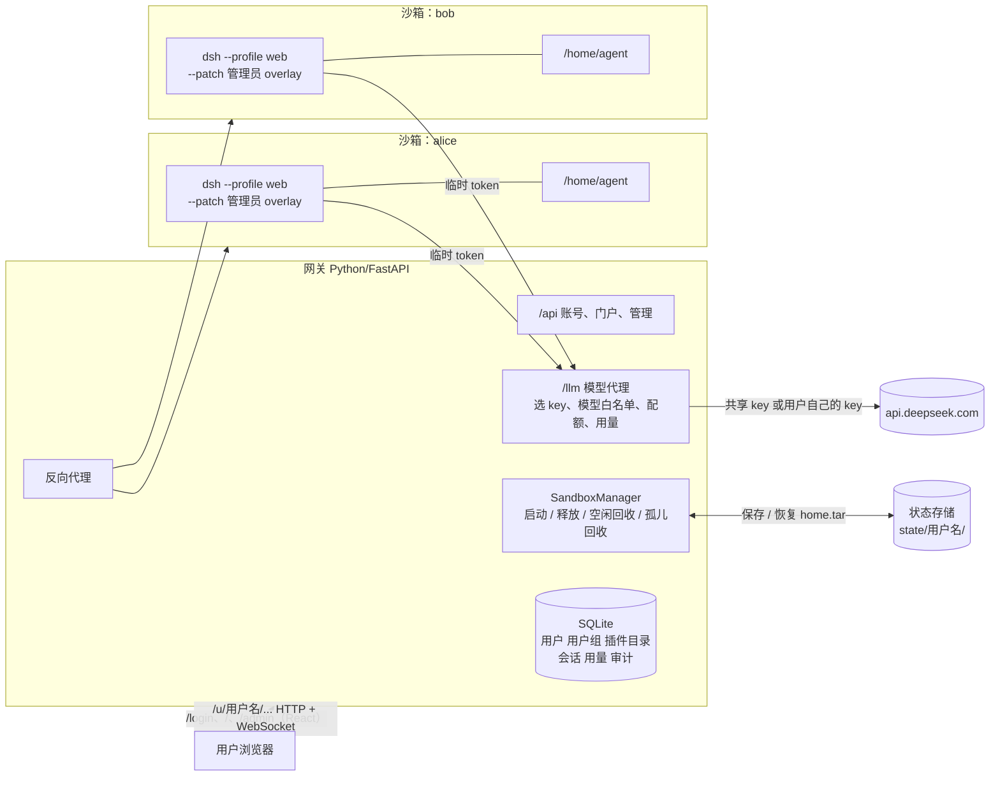

# dsh-cloud-sandbox

为每个账号分配一台独立的"云电脑"（沙箱），沙箱里运行一个完整的 [DeepSeek Harness](https://github.com/deepseek-ai/deepseek-harness)（dsh）Web；网关提供账号登录、个人门户和管理后台。

- **账号**：管理员创建账号，用户用用户名和密码登录；会话保存在服务端，可以强制下线。
- **云电脑**：打开门户时自动创建沙箱并恢复该用户上次的全部数据（会话、文件、记忆、自己装的插件）；退出、空闲超时或超过最长时长时，先保存再销毁，释放全部资源。
- **管理后台**：管理用户和用户组，按组或按人分配默认插件、MCP 服务和配置补丁，设置资源规格、模型权限、每日配额，查看用量和审计日志。
- **模型 Key**：团队共享 key 和用户自己的 key 都只保存在网关（用户 key 加密存储），永远不进入沙箱。

dsh 本身不做任何修改，沙箱里运行的是 npm 上的官方 `@deepseek-ai/dsh`。门户和管理后台用 React 编写，直接复用 dsh Web 的设计变量（颜色、圆角、字体、深色模式），和 dsh 界面风格一致。

> 状态：PoC。Docker 后端已端到端验证（登录、门户、管理后台、插件和 MCP 下发、对话、退出保存、再登录恢复、空闲回收、孤儿回收）；E2B 后端已实现但**未用真实 key 验证**。

## 目录

- [架构](#架构)
- [项目结构](#项目结构)
- [环境要求](#环境要求)
- [启动流程](#启动流程)
- [使用方法](#使用方法)
- [管理后台](#管理后台)
- [插件、MCP 与配置补丁的下发](#插件mcp-与配置补丁的下发)
- [用户数据存在哪里](#用户数据存在哪里)
- [沙箱生命周期](#沙箱生命周期)
- [请求流程](#请求流程)
- [安全模型](#安全模型)
- [配置项](#配置项)
- [E2B 后端](#e2b-后端未验证)
- [接入其他沙箱后端](#接入其他沙箱后端)
- [开发与测试](#开发与测试)
- [故障排查](#故障排查)
- [已知限制与上线前待办](#已知限制与上线前待办)

## 架构



整个方案做在 dsh 外面一层，而不是做成 dsh 插件：dsh 的文件系统和进程服务是整个进程共享的，插件无法按用户分配沙箱。所以每个用户运行一个独立的 dsh 进程，由网关负责编排它们的生命周期。

网关按 dsh 官方文档 [Publish the Web UI behind a reverse proxy](https://github.com/deepseek-ai/deepseek-harness/blob/master/docs/user/guide/public-deployments.md) 的要求做反向代理：

| dsh 的要求 | 网关的做法 |
|---|---|
| 保留浏览器发来的 Host | HTTP 和 WebSocket 都原样转发浏览器的 Host；`--trusted-host` 设为 `GATEWAY_PUBLIC_URL` 的主机名（loopback 地址 dsh 默认可信） |
| 去掉挂载前缀 | `/u/<user>/api/x` 转发为 `/api/x` |
| 转发 WebSocket 升级 | 双向转发，并统计连接数用于判断空闲 |
| cookie 作用域限定在挂载路径下 | dsh 的 `Set-Cookie: Path=/` 改写为 `Path=/u/<user>/` |
| 启动令牌换 cookie | 用户首次访问时，跳转到 dsh 打印的 `?token=` 链接，dsh 返回自己的会话 cookie |

## 项目结构

```
dsh-cloud-sandbox/
├── README.md
├── sandbox-image/                 沙箱镜像
│   ├── Dockerfile                 node:22 + @deepseek-ai/dsh + pnpm + git/python3，用户 agent
│   ├── entrypoint.sh              安装 MCP 包 → 启动 dsh（带管理员 overlay）→ 后台安装默认插件
│   └── provision.py               按 /etc/dsh-cloud/policy.json 为用户安装一次默认插件和 MCP 包
├── web/                           门户和管理后台（React + Vite + TypeScript）
│   ├── src/theme/                 从 dsh 的 ui-theme 复制的设计变量和字体
│   ├── src/pages/Login.tsx        登录页
│   ├── public/dsh-cloud-overlay.js 注入到 dsh Web 页面的"云电脑"浮动按钮：返回门户、保存并退出
│   ├── src/sandbox.ts             云电脑状态轮询和启动/释放进度模型
│   ├── src/pages/Portal.tsx       个人门户：电源面板（启动/保存释放/进入，带进度条）、API Key、用量、已分配插件、改密码
│   ├── src/pages/Admin.tsx        管理后台框架、概览、运行中的云电脑、审计日志
│   └── src/pages/admin/           用户、用户组、插件与 MCP；保存后提示重启受影响的云电脑
└── gateway/                       网关（Python）
    ├── run.sh                     启动脚本：读取 .env，启动 uvicorn
    ├── .env.example               配置模板
    ├── pyproject.toml / uv.lock
    ├── dsh_gateway/
    │   ├── app.py                 路由：/u/<user>/ 代理、/llm 模型代理、前端页面
    │   ├── api.py                 /api：登录、门户、管理后台
    │   ├── db.py                  SQLite：用户、用户组、插件目录、会话、用量、审计
    │   ├── auth.py                密码哈希（scrypt）、会话 token、API key 加密
    │   ├── policy.py              用户组和插件分配 → 沙箱的资源、policy.json、overlay
    │   ├── gateway.py             共享状态，首次启动时创建默认用户组和管理员
    │   ├── usage.py               从模型响应（含流式）里统计 token
    │   ├── proxy.py               HTTP / WebSocket 转发，cookie 与跳转改写
    │   ├── manager.py             每用户一个沙箱：启动、释放、空闲回收、孤儿回收
    │   ├── store.py               用户快照存储（本地目录，可替换为对象存储）
    │   ├── config.py              环境变量配置
    │   └── backends/
    │       ├── base.py            SandboxBackend 接口
    │       ├── docker_backend.py  Docker 实现（已验证）
    │       └── e2b_backend.py     E2B 实现（未验证）
    └── tests/                     单元测试（不需要 Docker）
```

## 环境要求

| 依赖 | 说明 |
|---|---|
| Docker | macOS 上用 OrbStack 或 Docker Desktop；Linux 见[故障排查](#故障排查) |
| [uv](https://docs.astral.sh/uv/) | 管理网关的 Python 环境，Python ≥ 3.11 |
| Node.js ≥ 22 + pnpm | 构建前端 |
| DeepSeek API key | 在 [platform.deepseek.com](https://platform.deepseek.com) 获取；也可以不配共享 key，让每个用户在门户填自己的 |

## 启动流程

### 1. 克隆仓库

```sh
git clone https://github.com/HanszZ16/dsh-cloud-sandbox.git
cd dsh-cloud-sandbox
```

### 2. 构建沙箱镜像

```sh
docker build -t dsh-sandbox:dev sandbox-image
```

国内网络安装 npm 包容易中断，可以通过本机代理构建（代理参数只在构建时生效，不会写进镜像）。下面的 `7897` 换成你的代理端口：

```sh
docker build -t dsh-sandbox:dev sandbox-image \
  --build-arg http_proxy=http://host.docker.internal:7897 \
  --build-arg https_proxy=http://host.docker.internal:7897
```

要换 dsh 版本，加 `--build-arg DSH_VERSION=<版本号>`，默认 `0.2.1-rc.2`。

### 3. 构建前端

```sh
cd web
pnpm install
pnpm build          # 输出到 web/dist，网关直接提供这些文件
cd ..
```

### 4. 配置网关

```sh
cd gateway
cp .env.example .env
```

编辑 `.env`，至少填写：

```sh
GATEWAY_SECRET_KEY=<一个随机长字符串>   # python3 -c "import secrets;print(secrets.token_urlsafe(32))"
GATEWAY_ADMIN_PASSWORD=<初始管理员密码>  # 首次启动时创建管理员账号 admin
DEEPSEEK_API_KEY=sk-...                 # 团队共享 key，可选
```

`GATEWAY_SECRET_KEY` 用来加密用户保存的 API key，**设置后不要再改**，否则已保存的用户 key 无法解密（用户需要重新填写）。`.env` 已被 `.gitignore` 排除。

### 5. 启动网关

```sh
./run.sh
```

`run.sh` 每次启动都会读取 `.env`，`.env` 里的值优先于终端里已有的同名环境变量。**修改 `.env` 后需要重启网关**。启动成功的日志：

```
INFO dsh_gateway: set administrator 'admin' from GATEWAY_ADMIN_PASSWORD   （仅首次）
INFO:     Uvicorn running on http://127.0.0.1:8000 (Press CTRL+C to quit)
```

### 6. 验证

1. 打开 http://localhost:8000 ，用 `admin` 和 `GATEWAY_ADMIN_PASSWORD` 登录；
2. 右上角进入**管理后台 → 用户**，新建一个普通用户；
3. 退出，用新用户登录，在门户的电源面板点**启动云电脑**，进度条走完（几秒）后点**进入 DeepSeek Harness**；
4. 第一次进入时 dsh 会显示预览说明，点 Continue；选择工作区时直接点 **Open**（即 `/home/agent`）；
5. 发一条消息。管理后台**概览**里的"今日模型请求"会增加。

### 从旧版本升级

旧版本（用户名直接登录）的数据仍在 `gateway/state/<用户名>/`。在管理后台用**同样的用户名**创建账号，登录后数据会原样恢复。`GATEWAY_LOGIN_PASSWORD` 已不再使用。

## 使用方法

| 页面 / 操作 | 说明 |
|---|---|
| `/login` | 登录页。账号由管理员创建 |
| `/`（门户） | 顶部的电源面板集中放置云电脑的操作；下方可设置自己的 API Key、修改密码、查看今日用量和管理员分配的插件 |
| 启动云电脑 | 显示分阶段进度条（读取数据 → 创建云电脑 → 恢复文件和会话 → 启动 DeepSeek Harness），完成后面板变绿 |
| 进入 DeepSeek Harness | 只有云电脑运行时可点；打开 `/u/<用户名>/`。直接访问这个地址时，云电脑没运行也会自动启动 |
| 保存并释放 | 显示进度条（停止并写盘 → 打包 → 保存 → 释放），不退出登录 |
| 保存并退出（门户右上角） | 保存并释放（带进度），然后退出登录 |
| dsh 页面右下角的"云电脑"按钮 | **返回门户**（云电脑继续运行）或 **保存并退出**（带进度，完成后回到登录页） |
| 直接关闭浏览器 | 云电脑继续保留，空闲超过所在用户组的时限（默认 15 分钟）后自动保存并释放 |

停止网关（`Ctrl+C`）时，所有运行中的云电脑都会先保存再销毁，最多等待 10 秒让浏览器的连接断开。

## 管理后台

只有管理员能进入 `/admin`，所有修改都会写入审计日志。

| 页面 | 功能 |
|---|---|
| 概览 | 用户数、运行中的云电脑、今日请求和 tokens、近 14 天请求柱状图 |
| 用户 | 新建、编辑（显示名、角色、用户组、停用、重置密码、单独分配插件）、删除（可选同时删除数据）；查看每人的云电脑状态和今日用量。停用或重置密码会让该用户的登录会话立即失效 |
| 用户组 | 每个用户属于一个组。组决定：内存和 CPU 上限、空闲释放时间、单次最长运行、能否使用共享 key、每日请求上限、允许的模型、默认插件 |
| 插件与 MCP | 维护插件目录（三种类型，见下节），再到用户组或用户里分配 |
| 运行中的云电脑 | 查看并强制保存释放 |
| 审计日志 | 登录、退出、账号与配置的修改记录 |

用户组、插件和用户分配的修改，在用户**下次启动云电脑时**生效。编辑器里有这条提醒；保存后如果有受影响的用户正在运行，会弹窗列出他们，可以选择**立即重启**（先保存数据，再用新配置启动，他们正在进行的任务会中断，dsh 页面需要刷新）。"运行中的云电脑"页也可以单独重启或释放某个用户，启动和保存中的云电脑也会显示在列表里。

保护措施：至少保留一个启用的管理员；不能删除自己；默认用户组不能删除，组内有用户时不能删除。

## 插件、MCP 与配置补丁的下发

管理员在目录里登记三种类型，网关在启动沙箱前把它们写成两个文件放进沙箱（root 所有、只读）：

| 类型 | 写入 | 在沙箱里怎么生效 | 用户能否去掉 |
|---|---|---|---|
| dsh 插件（bundle） | `/etc/dsh-cloud/policy.json` | dsh 启动后在后台执行 `dsh plugin --profile web add <spec>` 并启用；dsh Web 的热加载让插件装好后自动出现 | 能。每个插件每个用户只装一次（记录在 `~/.dsh-cloud/provisioned.json`），用户删掉或关掉后不会被重新装上 |
| MCP 服务 | `/etc/dsh-cloud/admin.cordis.yml` | 作为 `dsh --patch` overlay 插入一行 `@deepseek-ai/dsh-mcp-client`，每次启动都生效。可选填"安装包"（npm spec）：dsh 启动前为每个用户 `npm install -g` 一次，装进 `~/.local` 并随数据保存 | 不能，由管理员控制 |
| 配置补丁 | 同上 | 原样追加到 overlay 的 Cordis 补丁行（按 id 覆盖或 insert），每次启动生效 | 不能 |

dsh 的配置分层是：bundle → profile 的 `cordis.patch.yml` → home 的 `cordis.patch.yml` → `--patch` overlay。管理员 overlay 最后应用，所以它明确设置的行优先于用户自己的设置；**用户自己在 dsh 里装的插件、开关、补丁都在 `/home/agent` 里，随快照保存，不受管理员下发影响**。

几个要点：

- **默认插件在后台安装**：登录不会等插件装完。安装期间 dsh 持有 profile 锁，用户这段时间在 dsh 里保存插件或设置会提示失败，装完后恢复（门户上有说明）。插件很大时（例如 Codex 子代理带原生二进制）首次安装可能需要几分钟。安装失败或被打断，下次启动自动重试。
- **MCP 服务不要用 `npx`**：dsh 连接 stdio MCP 时会先启动一个探测进程再启动正式进程，两个 `npx` 同时安装会损坏 npx 缓存，并且这个损坏的缓存会随用户数据保存下来。请填写"安装包"，command 写安装包提供的命令名（例如 `@modelcontextprotocol/server-memory@2026.7.4` + `mcp-server-memory`），或者把 MCP 服务直接装进镜像。
- **MCP 的 env 和 headers 用户可读**：它们写在沙箱里的 overlay 文件中，stdio MCP 进程本身也运行在用户沙箱里，所以不要在这里放不希望用户看到的密钥。需要保密的服务，应由网关代理（见待办）。
- 首次进入沙箱需要安装的 npm 包和插件都通过 `SANDBOX_HTTP_PROXY` 出网（如果配置了）。

## 用户数据存在哪里

沙箱里的 `/home/agent` 就是用户的整台电脑，作为一个整体保存和恢复。

| 数据 | 位置 | 是否持久 |
|---|---|---|
| dsh 会话记录、设置、dsh 凭据、SQLite 存储 | 沙箱 `/home/agent/.dsh`（`DSH_HOME`） | ✅ 释放时进入快照，下次登录恢复 |
| 用户自己装的 dsh 插件、开关、补丁 | `/home/agent/.dsh/profiles/web/` | ✅ 同上 |
| 记忆（MCP 记忆服务的数据，例如 `~/.mcp-memory.jsonl`） | `/home/agent` 下 | ✅ 同上；配置 MCP 时请把数据路径放在 `/home/agent` 下 |
| 用户文件、项目、npm 全局包（`NPM_CONFIG_PREFIX=~/.local`）、dotfiles | `/home/agent` | ✅ 同上 |
| 已下发记录 | `/home/agent/.dsh-cloud/provisioned.json` | ✅ 同上 |
| 系统目录（`/usr`、`/tmp`、apt 软件、pnpm 内容缓存 `/var/cache/pnpm-store`） | 沙箱镜像层 | ❌ 每次启动回到镜像初始状态 |
| 快照文件 | 网关 `gateway/state/<用户名>/home.tar` | ✅ 原子写入（先写 `.partial` 再替换） |
| 账号、用户组、插件目录、会话、用量、审计 | 网关 `gateway/data/gateway.db`（SQLite） | ✅ |
| 用户自己的 API key | `gateway.db`，用 `GATEWAY_SECRET_KEY` 派生的密钥加密（Fernet） | ✅ 不进入沙箱 |
| 共享 API key | 网关进程的环境变量 | 不进入沙箱 |

## 沙箱生命周期

| 事件 | 动作 |
|---|---|
| 用户打开门户，或访问 `/u/<user>/` | 创建容器（按用户组的内存、CPU）→ 写入 `home.tar` 和 `/etc/dsh-cloud` 下的两个文件 → 安装待装的 MCP 包 → 启动 dsh → 等待 dsh 打印启动链接（本机约 3–6 秒）→ 后台安装待装的默认插件 |
| 用户点"保存并释放"或"保存并退出"（门户或 dsh 页面） | 停止容器（SIGTERM，让 dsh 把存储写盘）→ 打包 `/home/agent` → 写入快照 → 删除容器 → 吊销该沙箱的模型 token |
| 没有 WebSocket 连接，且空闲超过用户组的空闲时限 | 同上 |
| 运行超过用户组的单次最长运行时间 | 同上，不管是否活跃 |
| 管理员停用、删除账号，或在后台释放 | 同上 |
| 管理员在后台重启 | 同上，完成后立即用最新的用户组和插件配置重新启动 |
| 网关重启（包括崩溃后重启） | 找出带本网关实例标签（`dsh-cloud.instance=<GATEWAY_INSTANCE_ID>`）的残留容器，先保存再删除 |
| 保存失败 | **不删除容器**，记录错误日志，下次网关启动时作为残留容器重试，用户数据不会被丢弃 |

"活跃"的判断：浏览器的 HTTP 请求、WebSocket 消息，以及沙箱发出的模型请求都算活跃。所以用户关掉浏览器、agent 还在后台跑任务时，沙箱不会被回收。回收检查每 `SANDBOX_REAP_INTERVAL_S` 秒执行一次。

## 请求流程

**登录**

```
浏览器 POST /api/auth/login {username, password}
网关   → scrypt 校验密码 → 生成随机会话 token，数据库只存它的 SHA-256
       → Set-Cookie: dshgw_session=<token>; HttpOnly; SameSite=Lax
```

**首次进入 dsh（启动令牌换 cookie）**

```
浏览器 GET /u/alice/                     → 网关：未见 dsh cookie → 303 /u/alice/?token=<dsh 启动令牌>
浏览器 GET /u/alice/?token=...           → 网关转发 → dsh 返回 Set-Cookie: dsh-auth-...; Path=/
                                         → 网关改写为 Path=/u/alice/ → 303 ./
浏览器 GET /u/alice/                     → 带 dsh cookie，正常加载页面
浏览器 WS  /u/alice/api/remote.mux       → 网关转发到沙箱的 /api/remote.mux
```

跳转只保留路径和查询参数，不带主机名，所以用 `localhost` 或 `127.0.0.1` 访问都可以。

网关转发 dsh 的 HTML 页面时，会在 `</head>` 前插入 `<script src="/dsh-cloud-overlay.js" defer>`（dsh 没有 CSP，本身也使用内联脚本）。这个脚本在 Shadow DOM 里渲染右下角的"云电脑"按钮，颜色取自 dsh 自己的设计变量；它通过同源的 `/api/me/sandbox/release` 和 `/api/auth/logout` 完成保存并退出。

**启动和释放的进度**

`POST /api/me/sandbox/start` 和 `POST /api/me/sandbox/release` 都立即返回，实际工作在后台进行；`GET /api/me/sandbox` 返回 `status`（`starting` / `releasing` / `running` / `stopped` / `failed`）、当前阶段 `phase` 和该阶段已用时间 `phase_elapsed_s`。前端按阶段把进度映射到区间，并在阶段内平滑推进。各后端通过 `start(spec, progress)` 和 `capture(handle, progress)` 上报阶段。

**模型请求**

```
沙箱里的 dsh → POST http://host.docker.internal:8000/llm/anthropic/v1/messages
               x-api-key: dshgw-<该沙箱的临时 token>
网关         → token 属于哪个用户 → 账号是否停用
             → 选 key：用户自己的 key；没有则用共享 key（用户组允许时）
             → 模型是否在用户组的白名单里；今日请求是否超过上限（超过返回 429）
             → POST https://api.deepseek.com/anthropic/v1/messages（流式原样返回）
             → 从响应里统计 input/output tokens，记入用量
```

如果用户在 dsh 自己的设置里填了 key（不是网关签发的 `dshgw-` token），网关原样转发、不计用量（可用 `LLM_ALLOW_PASSTHROUGH=0` 关闭）。

沙箱里设置的环境变量：

| 变量 | 值 |
|---|---|
| `DEEPSEEK_API_KEY` | `dshgw-<随机>`，每次启动新签发，释放时吊销 |
| `DEEPSEEK_BASE_URL` | `<GATEWAY_SANDBOX_CALLBACK_URL>/llm/anthropic` |
| `DEEPSEEK_SEARCH_BASE_URL` | `<GATEWAY_SANDBOX_CALLBACK_URL>/llm/anthropic/v1`（dsh 默认的 Messages 联网搜索） |
| `HTTP(S)_PROXY`、`NO_PROXY` | 设置了 `SANDBOX_HTTP_PROXY` 时注入；`NO_PROXY` 包含回调网关的主机名 |

## 安全模型

- **账号**：密码用 scrypt 加盐哈希；会话 token 随机生成，数据库只存哈希；停用账号或重置密码会删除该用户的全部会话；不存在的用户名和错误密码耗时相同。
- **沙箱隔离**：每个用户一个容器，以非 root 用户 `agent`（uid 1001）运行，资源上限来自用户组，进程数上限 1024。
- **端口**：dsh 的端口只发布在网关主机的 `127.0.0.1` 上，外部无法直接访问，只能经过网关。
- **用户隔离**：访问 `/u/<user>/` 必须持有该用户的有效会话，否则跳回登录页；WebSocket 同样校验。
- **凭据**：共享 key 和用户 key 都只在网关；网关登录 cookie 在转发前剥离；dsh 自己的 cookie 只在 `/u/<user>/` 路径下有效。
- **管理员下发的边界**：管理员 overlay 里的行能保证生效，但用户在沙箱里有 shell，可以自己新增 MCP 或插件（这是设计如此）。真正需要强制的限制要放在沙箱外：模型只能经过网关（已做到）、出网白名单、敏感凭据不进沙箱。
- **PoC 的不足**：容器出网不受限制；见[已知限制](#已知限制与上线前待办)。

## 配置项

所有配置都通过 `gateway/.env`（或环境变量）设置。用户组的资源、配额、模型权限在管理后台里改；下表里的 `SANDBOX_*` 资源项只是**首次启动时默认用户组的初始值**。

| 变量 | 默认值 | 说明 |
|---|---|---|
| `GATEWAY_SECRET_KEY` | 每次启动随机生成 | 加密用户 API key 的密钥来源。**必须设置且保持不变** |
| `GATEWAY_ADMIN_USERNAME` | `admin` | 没有任何启用的管理员时，启动时创建的管理员用户名 |
| `GATEWAY_ADMIN_PASSWORD` | 空 | 上面这个管理员的密码；为空时不创建（日志会提示） |
| `GATEWAY_ADMIN_RESET_PASSWORD` | 空 | 设为 `1` 时每次启动都把上面的密码重新写给该管理员（找回密码用，用完删掉） |
| `GATEWAY_SESSION_TTL_S` | `604800`（7 天） | 登录会话有效期 |
| `DEEPSEEK_API_KEY` | 空 | 团队共享 key；为空时只有填了自己 key 的用户能用模型 |
| `DEEPSEEK_UPSTREAM` | `https://api.deepseek.com` | 模型代理转发的目标 |
| `LLM_ALLOW_PASSTHROUGH` | `1` | 是否原样转发用户在 dsh 设置里填的 key |
| `GATEWAY_PUBLIC_URL` | `http://localhost:8000` | 浏览器访问网关的地址，用作 dsh 的 `--public-url` 和 `--trusted-host` |
| `GATEWAY_SANDBOX_CALLBACK_URL` | `http://host.docker.internal:<GATEWAY_PUBLIC_URL 的端口>` | 沙箱访问网关模型代理的地址 |
| `GATEWAY_BIND` / `GATEWAY_PORT` | `127.0.0.1` / `8000` | 网关监听地址和端口（`run.sh` 使用）；改端口时同步修改 `GATEWAY_PUBLIC_URL` |
| `GATEWAY_INSTANCE_ID` | `default` | 本网关的实例 id，写在容器标签上；同一台 Docker 上运行多个网关时，每个网关用不同的值，互不回收对方的沙箱 |
| `GATEWAY_STATE_DIR` | `state` | 快照目录 |
| `GATEWAY_DB_PATH` | `data/gateway.db` | 账号数据库 |
| `GATEWAY_WEB_DIST` | `../web/dist` | 前端构建产物目录 |
| `SANDBOX_BACKEND` | `docker` | `docker` 或 `e2b` |
| `SANDBOX_DOCKER_IMAGE` | `dsh-sandbox:dev` | Docker 后端使用的镜像 |
| `SANDBOX_E2B_TEMPLATE` | 空 | E2B 后端必填 |
| `SANDBOX_HTTP_PROXY` | 空 | 沙箱出网代理（安装插件、npm 包、联网工具），例如 `http://host.docker.internal:7897` |
| `SANDBOX_MEM_LIMIT` / `SANDBOX_CPUS` | `2g` / `2` | 默认用户组的初始资源 |
| `SANDBOX_IDLE_TIMEOUT_S` / `SANDBOX_MAX_LIFETIME_S` | `900` / `28800` | 默认用户组的初始空闲时限和最长运行时间 |
| `SANDBOX_REAP_INTERVAL_S` | `15` | 回收检查间隔 |
| `SANDBOX_START_TIMEOUT_S` | `600` | 等待 dsh 启动的最长时间（包括首次安装 MCP 包） |

## E2B 后端（未验证）

`gateway/dsh_gateway/backends/e2b_backend.py` 按 E2B Python SDK 文档实现，**还没有用真实 key 运行过**。启用步骤：

1. 安装依赖：`cd gateway && uv sync --extra e2b`，并设置 `E2B_API_KEY`；
2. 用 `sandbox-image/Dockerfile` 构建 E2B template，把 template id 填到 `SANDBOX_E2B_TEMPLATE`；
3. 设置 `SANDBOX_BACKEND=e2b`；
4. `GATEWAY_SANDBOX_CALLBACK_URL` 必须是 E2B 能访问到的公网地址，因为沙箱要回连网关的模型代理。

E2B 的入口按 Host 路由，所以这个后端会把 Host 和 Origin 一起改写成 E2B 的地址，并把它设为 dsh 的 `--trusted-host`。资源规格由 template 决定，用户组里的内存和 CPU 在 E2B 上不生效。需要验证的点：

- dsh 绑定 `hostname -I` 的第一个地址后，E2B 的入口能否转发到；
- 改写 Host/Origin 后，dsh 的同源校验能否通过；
- 用 `runuser -u agent` 启动 dsh 后，环境变量是否完整传入；后台的插件安装进程能否正常退出。

## 接入其他沙箱后端

Daytona、Kubernetes + gVisor/Kata、Firecracker 等，只需要实现 `backends/base.py` 里的 `SandboxBackend`：

| 方法 | 职责 |
|---|---|
| `start(spec, progress)` | 按 `spec.resources` 创建机器，恢复 `spec.restore` 里的快照，写入 `spec.files`（root 所有、只读），启动 dsh，等它开始监听 |
| `launch_url(handle)` | 返回 dsh 启动时打印的带 token 链接 |
| `capture(handle, progress)` | 停止 dsh 让存储写盘，返回 `{"home": <tar>}`；用 `progress("stop")`、`progress("archive")` 上报阶段 |
| `destroy(handle)` | 释放机器的全部资源；机器已不存在时也要成功 |
| `list_orphans()` | 列出本网关实例创建、但已不再跟踪的机器 |
| `keepalive(handle)` | 可选：延长后端自己的超时（如 E2B） |

快照格式在各后端之间通用：一个以 `agent/` 为根的 tar，解压到 `/home`。`base.files_archive()` 把 `spec.files` 打成以 `/` 为根的 tar。然后在 `backends/__init__.py` 的 `create_backend` 里注册。

## 开发与测试

```sh
cd gateway
uv run pytest          # 单元测试：账号与权限、插件下发、模型代理的 key 选择/白名单/配额/用量、代理改写、生命周期（假后端，不需要 Docker）

cd ../web
pnpm typecheck
pnpm dev               # 前端热更新开发；/api 和 /u 转发到 GATEWAY_DEV_TARGET（默认 http://127.0.0.1:8000）
```

本地手动调试时，可以把空闲阈值调小（在管理后台改用户组，或者首次启动前设置 `SANDBOX_IDLE_TIMEOUT_S=60`），观察回收过程。

查看运行中的沙箱和它的日志（插件下发的日志以 `dsh-cloud provision:` 开头）：

```sh
docker ps --filter label=dsh-cloud
docker logs <容器名>
docker exec -it <容器名> bash
```

## 故障排查

| 现象 | 原因与处理 |
|---|---|
| 启动日志 `no administrator exists` | 没有设置 `GATEWAY_ADMIN_PASSWORD`。设置后重启网关 |
| 管理员密码忘了 | 用另一个管理员在后台重置；或在 `.env` 设置新的 `GATEWAY_ADMIN_PASSWORD` 和 `GATEWAY_ADMIN_RESET_PASSWORD=1` 后重启（`GATEWAY_ADMIN_USERNAME` 会被重新启用并设为管理员），登录后把 `GATEWAY_ADMIN_RESET_PASSWORD` 删掉 |
| 打开网关显示"前端尚未构建" | 在 `web/` 运行 `pnpm install && pnpm build` |
| dsh 里模型报 `no API key` / `503` | 用户没有自己的 key，且用户组不允许共享 key 或网关没配 `DEEPSEEK_API_KEY`。在门户填 key，或在用户组里打开共享 key |
| dsh 里模型报 `429 daily request limit` | 达到用户组的每日请求上限 |
| dsh 里模型报 `model ... is not allowed` | 模型不在用户组的白名单里 |
| 模型请求返回 `401` | 沙箱的临时 token 已失效（例如沙箱被释放后旧页面还在请求）。刷新页面会启动新沙箱 |
| 用户在 dsh 里保存设置提示失败 | 后台正在安装管理员分配的插件，dsh 持有 profile 锁。等安装完成（`docker logs` 里出现 `selected bundle`）再保存 |
| 默认插件没出现 | `docker logs <容器>` 查看 `dsh-cloud provision:` 行；失败会在下次启动重试；需要出网的话设置 `SANDBOX_HTTP_PROXY` |
| MCP 工具没出现，日志 `xxx: not found` | MCP 的 command 不存在。填写"安装包"，或把服务装进镜像；不要用 `npx`（见[下发](#插件mcp-与配置补丁的下发)） |
| 用户保存的 API key 失效 | `GATEWAY_SECRET_KEY` 被改过，旧密文无法解密；恢复原值，或让用户重新填写 |
| 网关重启后日志里出现一次 `WebSocket ... 403` | 正常现象：旧页面在沙箱启动前尝试重连 WebSocket，页面会自动重连，紧接着的 HTTP 请求会启动沙箱 |
| 登录后又跳回登录页 | 确认用的是同一个主机名访问（在 `127.0.0.1` 登录的状态不会带到 `localhost`） |
| 打开页面报"云电脑启动失败" | 页面会显示错误信息（dsh 启动失败时附带它的日志）；常见原因是镜像不存在（先执行第 2 步）或 Docker 没有运行 |
| `docker build` 时 npm 报 `ECONNRESET` | 网络问题，按第 2 步使用代理构建 |
| `failed to connect to the docker API` | Docker 没有运行；OrbStack 用户执行 `orb start` |
| Linux 上沙箱访问不到模型代理 | Linux 上 `host.docker.internal` 指向 docker0 网桥，网关需要监听在该地址：`GATEWAY_BIND=0.0.0.0`（并用防火墙限制外部访问）或 docker0 的 IP |

## 已知限制与上线前待办

- **企业登录**：接入 OIDC/SSO（飞书、企业微信等）；目前只有用户名密码，没有登录失败限流；
- **快照存储**：换成 S3/OSS，加版本保留和配额；数据量大时改为增量同步或给每个用户挂持久卷；
- **出网与凭据**：限制沙箱出网（白名单）；需要保密的 MCP 服务由网关代理，凭据不进沙箱；
- **用量**：目前按请求次数限额、按 token 统计；可以加 token 配额和计费；
- **多实例**：网关的沙箱状态在内存里，多个网关共同服务同一批用户时需要把状态移到 Redis/数据库并加分布式锁（`GATEWAY_INSTANCE_ID` 只解决了互不回收）；
- **体验**：dsh 第一次进入时要手动选择工作区；WebSocket 重连不会触发沙箱启动；默认插件安装进度只在容器日志里，门户上看不到；管理员重启用户的云电脑后，用户已打开的 dsh 页面需要手动刷新；
- **规格**：加预热池降低冷启动时间；
- **dsh 版本**：基于 `@deepseek-ai/dsh@0.2.1-rc.2` 验证，dsh 仍处于预览阶段，升级版本后需要重新验证反向代理、启动令牌流程、`--patch` 和 `dsh plugin add` 的行为；升级时同步更新 `web/src/theme/` 里的设计变量。
