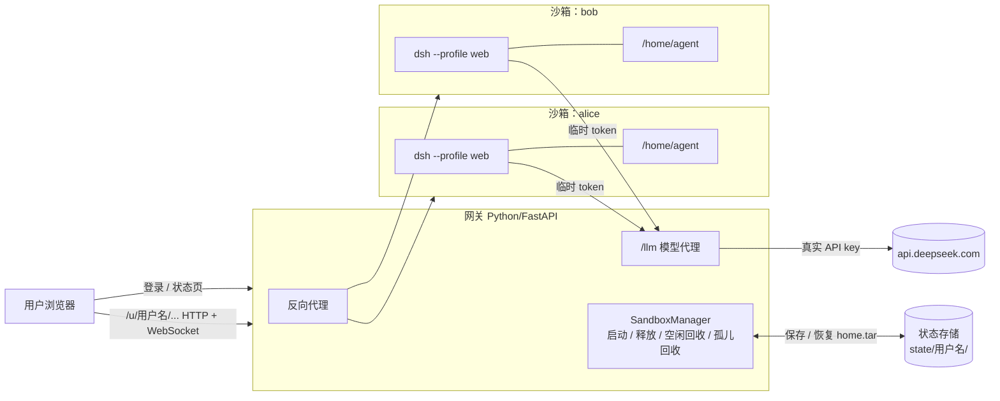

# dsh-cloud-sandbox

为每个登录用户分配一台独立的"云电脑"（沙箱），沙箱里运行一个完整的 [DeepSeek Harness](https://github.com/deepseek-ai/deepseek-harness)（dsh）Web。

- 用户登录：自动创建沙箱，恢复该用户上次的文件和会话，启动 dsh。
- 用户退出 / 空闲超时 / 超过最长时长：先保存用户数据，再销毁沙箱，释放全部资源。
- 真实的 DeepSeek API key 只放在网关上，永远不进入沙箱。

dsh 本身不做任何修改，沙箱里运行的是 npm 上的官方 `@deepseek-ai/dsh`。

> 状态：PoC。Docker 后端已端到端验证（登录、对话、退出保存、再登录恢复、空闲回收、网关崩溃后的孤儿回收）；E2B 后端已实现但**未用真实 key 验证**。

## 目录

- [架构](#架构)
- [项目结构](#项目结构)
- [环境要求](#环境要求)
- [启动流程](#启动流程)
- [使用方法](#使用方法)
- [用户数据存在哪里](#用户数据存在哪里)
- [沙箱生命周期](#沙箱生命周期)
- [请求流程](#请求流程)
- [安全模型](#安全模型)
- [配置项](#配置项)
- [E2B 后端](#e2b-后端未验证)
- [接入其他沙箱后端](#接入其他沙箱后端)
- [开发与测试](#开发与测试)
- [故障排查](#故障排查)
- [已知限制与上线前待办](#已知限制与上线前待办)

## 架构



整个方案做在 dsh 外面一层，而不是做成 dsh 插件：dsh 的文件系统和进程服务是整个进程共享的，插件无法按用户分配沙箱。所以每个用户运行一个独立的 dsh 进程，由网关负责编排它们的生命周期。

网关按 dsh 官方文档 [Publish the Web UI behind a reverse proxy](https://github.com/deepseek-ai/deepseek-harness/blob/master/docs/user/guide/public-deployments.md) 的要求做反向代理：

| dsh 的要求 | 网关的做法 |
|---|---|
| 保留浏览器发来的 Host | HTTP 和 WebSocket 都原样转发浏览器的 Host；`--trusted-host` 设为 `GATEWAY_PUBLIC_URL` 的主机名（loopback 地址 dsh 默认可信） |
| 去掉挂载前缀 | `/u/<user>/api/x` 转发为 `/api/x` |
| 转发 WebSocket 升级 | 双向转发，并统计连接数用于判断空闲 |
| cookie 作用域限定在挂载路径下 | dsh 的 `Set-Cookie: Path=/` 改写为 `Path=/u/<user>/` |
| 启动令牌换 cookie | 用户首次访问时，跳转到 dsh 打印的 `?token=` 链接，dsh 返回自己的会话 cookie |

## 项目结构

```
dsh-cloud-sandbox/
├── README.md
├── sandbox-image/                 沙箱镜像
│   ├── Dockerfile                 node:22 + @deepseek-ai/dsh + git/python3，用户 agent
│   └── entrypoint.sh              绑定容器自身 IP 启动 dsh --profile web
└── gateway/                       网关（Python）
    ├── run.sh                     启动脚本：读取 .env，启动 uvicorn
    ├── .env.example               配置模板
    ├── pyproject.toml / uv.lock
    ├── dsh_gateway/
    │   ├── app.py                 路由：登录、状态页、/u/<user>/ 代理、/llm 模型代理
    │   ├── proxy.py               HTTP / WebSocket 转发，cookie 与跳转改写
    │   ├── manager.py             每用户一个沙箱：启动、释放、空闲回收、孤儿回收
    │   ├── store.py               用户快照存储（本地目录，可替换为对象存储）
    │   ├── config.py              环境变量配置
    │   └── backends/
    │       ├── base.py            SandboxBackend 接口
    │       ├── docker_backend.py  Docker 实现（已验证）
    │       └── e2b_backend.py     E2B 实现（未验证）
    └── tests/                     单元测试（不需要 Docker）
```

## 环境要求

| 依赖 | 说明 |
|---|---|
| Docker | macOS 上用 OrbStack 或 Docker Desktop；Linux 见[故障排查](#故障排查) |
| [uv](https://docs.astral.sh/uv/) | 管理网关的 Python 环境，Python ≥ 3.11 |
| DeepSeek API key | 在 [platform.deepseek.com](https://platform.deepseek.com) 获取 |

## 启动流程

### 1. 克隆仓库

```sh
git clone https://github.com/HanszZ16/dsh-cloud-sandbox.git
cd dsh-cloud-sandbox
```

### 2. 构建沙箱镜像

```sh
docker build -t dsh-sandbox:dev sandbox-image
```

国内网络安装 npm 包容易中断，可以通过本机代理构建（代理参数只在构建时生效，不会写进镜像）。下面的 `7897` 换成你的代理端口：

```sh
docker build -t dsh-sandbox:dev sandbox-image \
  --build-arg http_proxy=http://host.docker.internal:7897 \
  --build-arg https_proxy=http://host.docker.internal:7897
```

要换 dsh 版本，加 `--build-arg DSH_VERSION=<版本号>`，默认 `0.2.1-rc.2`。

### 3. 配置网关

```sh
cd gateway
cp .env.example .env
```

编辑 `.env`，至少填写：

```sh
DEEPSEEK_API_KEY=sk-...
GATEWAY_SECRET_KEY=<一个随机长字符串>   # 例如 python3 -c "import secrets;print(secrets.token_urlsafe(32))"
```

`.env` 已被 `.gitignore` 排除，不会被提交。

### 4. 启动网关

```sh
./run.sh
```

`run.sh` 每次启动都会读取 `.env`，`.env` 里的值优先于终端里已有的同名环境变量。**修改 `.env` 后需要重启网关**（`Ctrl+C` 后重新运行）。

首次运行时 uv 会自动创建虚拟环境并安装依赖。启动成功的日志：

```
INFO:     Application startup complete.
INFO:     Uvicorn running on http://127.0.0.1:8000 (Press CTRL+C to quit)
```

如果出现 `DEEPSEEK_API_KEY is not set`，说明 key 没有读到，见[故障排查](#故障排查)。

### 5. 验证

1. 打开 http://localhost:8000（`http://127.0.0.1:8000` 也可以）；
2. 输入用户名（小写字母、数字、连字符）登录，大约 2 秒后进入 dsh 界面；
3. 第一次进入时 dsh 会显示预览说明，点 Continue；选择工作区时直接点 **Open**（即 `/home/agent`）；
4. 发一条消息。网关日志里出现 `POST /llm/anthropic/v1/messages ... 200` 即表示模型链路正常；
5. 运行 `docker ps --filter label=dsh-cloud`，能看到 `dsh-sbx-<用户名>-xxxxxx` 容器。

## 使用方法

| 页面 / 操作 | 说明 |
|---|---|
| `http://localhost:8000/` | 未登录时是登录页；已登录时显示沙箱状态（运行时长、空闲时长、连接数） |
| 打开 DeepSeek Harness | 进入 `/u/<用户名>/`，沙箱未运行时会自动启动并恢复数据 |
| 退出并释放沙箱 | 保存数据 → 销毁沙箱 → 清除登录状态 |
| 直接关闭浏览器 | 沙箱继续保留，空闲超过 `SANDBOX_IDLE_TIMEOUT_S`（默认 15 分钟）后自动保存并释放 |

停止网关（`Ctrl+C`）时，所有运行中的沙箱都会先保存再销毁，最多等待 10 秒让浏览器的连接断开。

## 用户数据存在哪里

沙箱里的 `/home/agent` 就是用户的整台电脑，作为一个整体保存和恢复。

| 数据 | 位置 | 是否持久 |
|---|---|---|
| dsh 会话记录、设置、插件、SQLite 存储 | 沙箱 `/home/agent/.dsh`（`DSH_HOME`） | ✅ 释放时进入快照，下次登录恢复 |
| 用户文件、项目、`pip --user` / npm 全局包、dotfiles | 沙箱 `/home/agent` | ✅ 同上 |
| 系统目录（`/usr`、`/tmp`、apt 安装的软件） | 沙箱镜像层 | ❌ 每次登录都回到镜像初始状态；需要的软件请写进 `sandbox-image/Dockerfile` |
| 快照文件 | 网关 `gateway/state/<用户名>/home.tar` | ✅ 跨沙箱保留，原子写入（先写 `.partial` 再替换） |
| 真实 DeepSeek API key | 网关进程的环境变量 | 不进入沙箱 |
| 网关登录 cookie | 浏览器 | 转发到沙箱前会被剥离 |

**Memory**：dsh 没有内置 memory，需要通过 MCP 接入（如 Memorix、MCP Reference Memory、Engram，见 dsh 文档 `docs/user/guide/mcp-memory.md`）。stdio MCP 服务器作为 dsh 的子进程运行在沙箱里，只要把它的数据库放在 `/home/agent` 下，就会随快照一起持久化。

## 沙箱生命周期

| 事件 | 动作 |
|---|---|
| 登录后首次访问 `/u/<user>/` | 创建容器 → 把 `home.tar` 解压进去 → 启动 dsh → 等待 dsh 打印启动链接（本机约 1.6 秒） |
| 用户点"退出并释放沙箱" | 停止容器（SIGTERM，让 dsh 把存储写盘）→ 打包 `/home/agent` → 写入快照 → 删除容器 → 吊销该沙箱的模型 token |
| 没有 WebSocket 连接，且空闲超过 `SANDBOX_IDLE_TIMEOUT_S` | 同上 |
| 运行超过 `SANDBOX_MAX_LIFETIME_S` | 同上，不管是否活跃 |
| 网关重启（包括崩溃后重启） | 找出所有带 `dsh-cloud` 标签的残留容器，先保存再删除 |
| 保存失败 | **不删除容器**，记录错误日志，下次网关启动时作为残留容器重试，用户数据不会被丢弃 |

"活跃"的判断：浏览器的 HTTP 请求、WebSocket 消息，以及沙箱发出的模型请求都算活跃。所以用户关掉浏览器、agent 还在后台跑任务时，沙箱不会被回收。回收检查每 `SANDBOX_REAP_INTERVAL_S` 秒执行一次。

## 请求流程

**首次进入（启动令牌换 cookie）**

```
浏览器 GET /u/alice/                     → 网关：未见 dsh cookie → 303 /u/alice/?token=<dsh 启动令牌>
浏览器 GET /u/alice/?token=...           → 网关转发 → dsh 返回 Set-Cookie: dsh-auth-...; Path=/
                                         → 网关改写为 Path=/u/alice/ → 303 ./
浏览器 GET /u/alice/                     → 带 dsh cookie，正常加载页面
浏览器 WS  /u/alice/api/remote.mux       → 网关转发到沙箱的 /api/remote.mux
```

跳转只保留路径和查询参数，不带主机名，所以用 `localhost` 或 `127.0.0.1` 访问都可以。

**模型请求**

```
沙箱里的 dsh → POST http://host.docker.internal:8000/llm/anthropic/v1/messages
               x-api-key: dshgw-<该沙箱的临时 token>
网关         → 校验 token 属于哪个用户 → 换成真实 key
             → POST https://api.deepseek.com/anthropic/v1/messages（流式原样返回）
```

沙箱里设置的环境变量：

| 变量 | 值 |
|---|---|
| `DEEPSEEK_API_KEY` | `dshgw-<随机>`，每次启动新签发，释放时吊销 |
| `DEEPSEEK_BASE_URL` | `<GATEWAY_SANDBOX_CALLBACK_URL>/llm/anthropic` |
| `DEEPSEEK_SEARCH_BASE_URL` | `<GATEWAY_SANDBOX_CALLBACK_URL>/llm/anthropic/v1`（dsh 默认的 Messages 联网搜索） |

## 安全模型

- **沙箱隔离**：每个用户一个容器，以非 root 用户 `agent`（uid 1001）运行，限制 2 CPU、2 GB 内存、1024 个进程。
- **端口**：dsh 的端口只发布在网关主机的 `127.0.0.1` 上，外部无法直接访问，只能经过网关。
- **用户隔离**：访问 `/u/<user>/` 必须持有该用户的网关登录 cookie（itsdangerous 签名），否则跳回登录页；WebSocket 同样校验。
- **凭据**：真实 API key 只在网关；网关登录 cookie 在转发前剥离；dsh 自己的 cookie 只在 `/u/<user>/` 路径下有效。
- **PoC 的不足**：登录只校验用户名（可选共享密码），容器出网不受限制，没有按用户计费和限流。见[已知限制](#已知限制与上线前待办)。

## 配置项

所有配置都通过 `gateway/.env`（或环境变量）设置。

| 变量 | 默认值 | 说明 |
|---|---|---|
| `DEEPSEEK_API_KEY` | 空 | 真实 key，只供模型代理使用。为空时模型请求返回 503 |
| `DEEPSEEK_UPSTREAM` | `https://api.deepseek.com` | 模型代理转发的目标 |
| `GATEWAY_PUBLIC_URL` | `http://localhost:8000` | 浏览器访问网关的地址，用作 dsh 的 `--public-url` 和 `--trusted-host` |
| `GATEWAY_SANDBOX_CALLBACK_URL` | `http://host.docker.internal:<GATEWAY_PUBLIC_URL 的端口>` | 沙箱访问网关模型代理的地址 |
| `GATEWAY_BIND` | `127.0.0.1` | 网关监听地址（`run.sh` 使用） |
| `GATEWAY_PORT` | `8000` | 网关监听端口（`run.sh` 使用）；修改时同步修改 `GATEWAY_PUBLIC_URL` 的端口 |
| `GATEWAY_SECRET_KEY` | 每次启动随机生成 | 签名登录 cookie；不设置的话网关重启后所有用户需要重新登录 |
| `GATEWAY_LOGIN_PASSWORD` | 空 | 共享登录密码；为空时任何用户名都能登录（仅限本机试用） |
| `GATEWAY_STATE_DIR` | `state`（相对 `gateway/`） | 快照目录 |
| `SANDBOX_BACKEND` | `docker` | `docker` 或 `e2b` |
| `SANDBOX_DOCKER_IMAGE` | `dsh-sandbox:dev` | Docker 后端使用的镜像 |
| `SANDBOX_E2B_TEMPLATE` | 空 | E2B 后端必填 |
| `SANDBOX_IDLE_TIMEOUT_S` | `900` | 空闲多久后释放 |
| `SANDBOX_MAX_LIFETIME_S` | `28800` | 单个沙箱最长运行时间 |
| `SANDBOX_REAP_INTERVAL_S` | `15` | 回收检查间隔 |
| `SANDBOX_START_TIMEOUT_S` | `90` | 等待 dsh 启动的最长时间 |

## E2B 后端（未验证）

`gateway/dsh_gateway/backends/e2b_backend.py` 按 E2B Python SDK 文档实现，**还没有用真实 key 运行过**。启用步骤：

1. 安装依赖：`cd gateway && uv sync --extra e2b`，并设置 `E2B_API_KEY`；
2. 用 `sandbox-image/Dockerfile` 构建 E2B template，把 template id 填到 `SANDBOX_E2B_TEMPLATE`；
3. 设置 `SANDBOX_BACKEND=e2b`；
4. `GATEWAY_SANDBOX_CALLBACK_URL` 必须是 E2B 能访问到的公网地址，因为沙箱要回连网关的模型代理。

E2B 的入口按 Host 路由，所以这个后端会把 Host 和 Origin 一起改写成 E2B 的地址，并把它设为 dsh 的 `--trusted-host`。需要验证的点：

- dsh 绑定 `hostname -I` 的第一个地址后，E2B 的入口能否转发到；
- 改写 Host/Origin 后，dsh 的同源校验能否通过；
- 用 `runuser -u agent` 启动 dsh 后，环境变量是否完整传入。

## 接入其他沙箱后端

Daytona、Kubernetes + gVisor/Kata、Firecracker 等，只需要实现 `backends/base.py` 里的 `SandboxBackend`：

| 方法 | 职责 |
|---|---|
| `start(spec)` | 创建机器，恢复 `spec.restore` 里的快照，启动 dsh，等它开始监听 |
| `launch_url(handle)` | 返回 dsh 启动时打印的带 token 链接 |
| `capture(handle)` | 停止 dsh 让存储写盘，返回 `{"home": <tar>}` |
| `destroy(handle)` | 释放机器的全部资源；机器已不存在时也要成功 |
| `list_orphans()` | 列出本后端创建、但网关已不再跟踪的机器 |
| `keepalive(handle)` | 可选：延长后端自己的超时（如 E2B） |

快照格式在各后端之间通用：一个以 `agent/` 为根的 tar，解压到 `/home`。然后在 `backends/__init__.py` 的 `create_backend` 里注册。

## 开发与测试

```sh
cd gateway
uv run pytest          # 单元测试：代理改写规则、生命周期（使用假后端，不需要 Docker）
```

本地手动调试时，可以把空闲阈值调小，观察回收过程：

```sh
SANDBOX_IDLE_TIMEOUT_S=60 ./run.sh
```

查看运行中的沙箱和它的 dsh 日志：

```sh
docker ps --filter label=dsh-cloud
docker logs <容器名>
docker exec -it <容器名> bash
```

## 故障排查

| 现象 | 原因与处理 |
|---|---|
| 模型请求返回 `503`，启动日志有 `DEEPSEEK_API_KEY is not set` | 网关进程没有读到 key。确认 `gateway/.env` 里已填写，然后**重启网关** |
| 模型请求返回 `401` | 沙箱的临时 token 已失效（例如沙箱被释放后旧页面还在请求）。刷新页面会启动新沙箱 |
| 网关重启后日志里出现一次 `WebSocket ... 403` | 正常现象：旧页面在沙箱启动前尝试重连 WebSocket，被拒绝后页面会自动重连，紧接着的 HTTP 请求会启动沙箱 |
| 登录后又跳回登录页 | 确认用的是同一个主机名访问（在 `127.0.0.1` 登录的状态不会带到 `localhost`，浏览器把它们当成不同的网站） |
| 打开页面报"启动失败" | 页面会显示错误信息（dsh 启动失败时附带它的日志）；常见原因是镜像不存在（先执行第 2 步）或 Docker 没有运行 |
| `docker build` 时 npm 报 `ECONNRESET` | 网络问题，按第 2 步使用代理构建 |
| `failed to connect to the docker API` | Docker 没有运行；OrbStack 用户执行 `orb start` |
| Linux 上沙箱访问不到模型代理 | Linux 上 `host.docker.internal` 指向 docker0 网桥，网关需要监听在该地址：`GATEWAY_BIND=0.0.0.0`（并用防火墙限制外部访问）或 docker0 的 IP |
| 不能同时运行两个网关 | 当前所有网关共用 `dsh-cloud` 标签，后启动的网关会把前一个网关的沙箱当成残留容器回收。同一台 Docker 上只运行一个网关 |

## 已知限制与上线前待办

- **用户体系**：接入 OAuth/SSO，替换现在的用户名登录；
- **快照存储**：换成 S3/OSS，加版本保留和配额；数据量大时改为增量同步（restic/rsync）或给每个用户挂持久卷；
- **网络与计费**：限制沙箱出网；模型代理按用户计费、限流；
- **多实例**：网关的沙箱状态目前在内存里，多实例部署需要移到 Redis/数据库并加分布式锁，容器标签加上网关实例 ID；
- **体验**：dsh 第一次进入时要手动选择工作区；WebSocket 重连不会触发沙箱启动；
- **规格**：沙箱规格（目前 2 CPU / 2 GB）可配置化，加预热池降低冷启动时间；
- **dsh 版本**：基于 `@deepseek-ai/dsh@0.2.1-rc.2` 验证，dsh 仍处于预览阶段，升级版本后需要重新验证反向代理和启动令牌流程。
