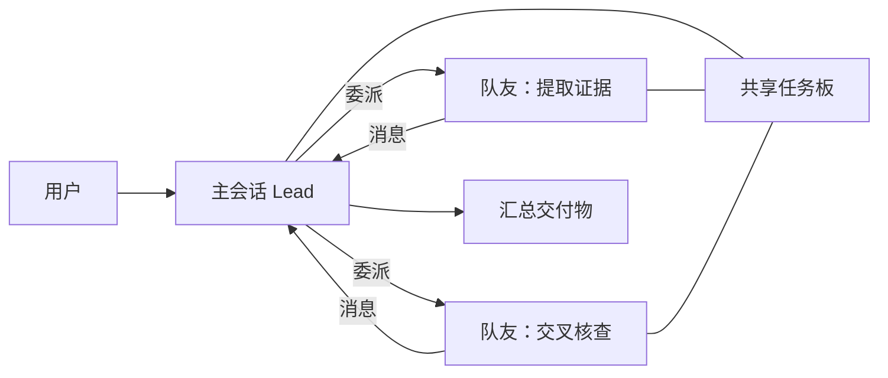

# 多智能体协同办公：从 Grok Bot 到 dsh-cloud-sandbox

项目的基础镜像已经锁定 dsh `0.2.2-alpha.3`，其中自带实验性「智能体团队」。它适合先做**一个用户、一次办公任务、多个分工明确的智能体**：一个主智能体负责拆分和验收，队友并行处理，各自保留会话，通过消息和任务板交接。Grok Bot 还提供可以加入多人房间的团队机器人，那是另一层能力。

本项目另提供[协作房间插件](../sandbox-image/base/plugins/workspace-rooms/README.md)：具名机器人在同一个私人群聊里各自使用原生会话，按 `@名字` 接收任务。房间与 Agent Teams 的会话内委派可以同时使用。

## 在项目里试跑

1. 进入你自己的工作空间，打开 **设置 → 插件**，开启 **智能体团队**，然后刷新页面。若找不到该条目，先确认当前沙箱实际运行的 dsh 版本；修改构建参数不会更新已经运行的旧镜像。
2. 新建一个会话，发送下面的提示。先把两三份适合测试的资料放进当前项目，例如 `inputs/`。
3. 打开会话页头的团队面板：检查两名队友是否有独立会话、共享任务是否完成，以及 `deliverables/brief.md` 是否能从文件面板打开。可以点开各队友会话，对照它的发现和交接消息。

```text
请使用「智能体团队」处理 inputs/ 中的资料，最后给我一页决策简报。
先建立共享任务板，并行委派两名队友：
- researcher：提取关键事实、数字和出处，注明文件名及页码或章节。
- reviewer：独立核对各资料之间的矛盾、口径差异和缺失信息。
两人都只读资料，用团队消息把发现发给你，并更新各自任务的状态。
把汇总任务设为依赖前两个任务；等两人完成后，由你一个人写入
deliverables/brief.md。列出结论、证据、仍需确认的事项和下一步建议。
```

需要从命令行启用时，在**已初始化的目标沙箱**里执行以下命令，再刷新工作空间页面：

```sh
dsh plugin --profile web add @deepseek-ai/dsh-experimental-agent-team-profile
```

这是一个自带的组合包，同时启用服务、模型工具和 Web 界面。它会切换顶层的普通子智能体委派工具；Workflow 的一次性子智能体仍可用，Web 预设里的同类控件也可能仍在。试点结束可在同一插件页关闭。[该版本的官方启用说明](https://github.com/deepseek-ai/deepseek-harness/blob/dsh-v0.2.2-alpha.3/packages/experimental/agent-team-profile/README.zh.md)

如果需要给试点用户组默认启用，可复用[管理后台的插件下发](../README.zh.md#插件mcp-与配置补丁的下发)：登记为 **dsh 插件**，填写 spec `@deepseek-ai/dsh-experimental-agent-team-profile@0.2.2-alpha.3`，分配给对应用户组，然后在方便时重启该组工作空间。项目的下发机制只做一次安装和启用，用户随后可以关闭。先确认目标组的镜像使用同一 dsh 版本。

## Grok Bot 的协同如何实现

本机目标是 `/Applications/Grok Bot.app`，版本 `0.70.2`，Electron 主包为 `Contents/Resources/app.asar`。客户端代码展示了几条相互独立的调用链：

| 能力 | 安装包中的直接证据 |
|---|---|
| 团队机器人名册 | `GrokBotAgent` 有身份、职责、团队、可见性和归属字段。渲染层通过桌面桥调用 `listGrokBotTeamAgents()`，Electron 主进程调用 `GrokBotService` 的同名 RPC 并整理返回的名册。 |
| 多人和机器人共用房间 | `CreateGrokBotRoom` 接收机器人 ID 和人类用户 ID。`RequestGrokBotRoomMemberTurn` 针对指定成员，携带房间、其他成员、新消息、`nonce` 和截止时间。另有取消轮次和按 `nonce` 回传结果的 RPC；结果区分已发言、跳过、超时、取消和错误等。 |
| 机器人之间直接交接 | `SendGrokBotAgentMessage` 接收发送方、接收方、消息 ID、正文和可选回复 ID。返回值定义了 `DELIVERED_TEMPORAL`、`DELIVERED_BOX`、重复、禁止和目标不可达等状态。这显示了协议区分的投递路径与结果。 |
| 单次任务派生子智能体 | 执行协议的 `SubagentArgs` 有任务提示、类型、模型、只读、父会话、后台运行及 fork/resume 等字段；`SubagentAwaitArgs` 可按 ID 限时等待。客户端另外按父 Agent 获取运行中的子智能体，接收名册更新事件；子智能体仍在运行时，父会话可继续显示活动。 |
| 用户看到的任务进度 | `ListGrokBotAgentTasks`、`MarkGrokBotAgentTaskDone` 和 `MarkGrokBotAgentTaskRead` 对应任务状态和未读。协调器转发任务变更，渲染层单独加载任务视图。安装包没有给出足够证据将这套视图等同于后台共享任务依赖图。 |

桌面端启动独立的 `sand-node-agent-coordinator` Electron utility process，通过消息端口连接主进程和渲染层。名册、任务、活动状态与对话视图经这层或桌面桥进入 UI。房间的接口支持对特定成员发起一轮工作并收回结果；**由谁决定派哪个成员、何时并发、如何重试或恢复，安装包里的客户端证据没有回答**。同理，执行协议有 `readonly` 字段，不足以证明每条执行路径都落实了只读权限。

## DSH 已实现的对应能力

DSH 用主会话作为团队边界。主智能体用 `spawn_teammate` 创建具名队友，可从独立上下文启动，也可 fork 主会话已完成的轮次。队友可以通过 `send_message` 给同一团队里的其他成员发消息；消息进入目标会话的收件箱。`wait_agent` 等待团队变化，主智能体随后重读状态。只有主智能体可以创建队友或中断队友当前轮次。



共享任务支持负责人、依赖、完成状态和版本检查：依赖完成后才能认领，旧版本的更新会被拒绝。Web 面板实时展示成员和任务，可进入成员会话；当前看板只读，模型通过工具创建和修改任务。默认组合包最多创建 8 名队友，支持 256 个活动任务。[服务机制](https://github.com/deepseek-ai/deepseek-harness/blob/dsh-v0.2.2-alpha.3/packages/experimental/agent-team/README.zh.md) · [Web 界面](https://github.com/deepseek-ai/deepseek-harness/blob/dsh-v0.2.2-alpha.3/packages/experimental/client-ui-agent-team/README.zh.md)

团队运行在现有的**单用户沙箱**内，同一团队的模型请求沿用[网关](../gateway/dsh_gateway/app.py)按用户配置的模型、配额和用量统计。成员共享工作目录，任务板的路径冲突提示不会锁文件；共享的[远程浏览器](../sandbox-image/base/browser-hub/hub.mjs)也只有一个。试点时只让一个队友使用浏览器，或安排它们轮流使用；让 Lead 负责最终写入。

成员和任务记录随会话保存，项目文件随 `/home/agent` 保存。沙箱休眠或达到最长寿命时进程会停止；重新进入可以查看保存的状态，进行中的模型调用或工具进程不会从断点自动继续。长期驻留、跨账号群聊、离开后持续运行属于后续能力：若确有需求，再为它们增加独立于沙箱生命周期的任务调度、可重试的交接和明确的跨账号权限。第一阶段按会话运行即可。

## 验证与证据位置

- **DSH `0.2.2-alpha.3`**：用发布版包和[上游测试的确定性模拟模型](https://github.com/deepseek-ai/deepseek-harness/blob/dsh-v0.2.2-alpha.3/apps/cli/tests/agent-team-headless.e2e.ts)，在独立的临时环境验证了两名队友、成员消息、依赖任务完成、Lead 等待与汇总；检查了三份持久会话日志。临时 Web 实例的认证入口与脚本加载通过，启动诊断显示团队服务、工具和界面三个组件已激活。本次没有操作浏览器里的团队面板、使用真实模型或替现有用户开启插件。
- **Grok Bot 包标识**：`app.asar` SHA-256 为 `8dd7b6c4a58439d626a9a7b3766982b7c725db2bc1f6ff68a29fc1ec62ca4cf7`。REA 6.4.0 静态分析了从该包提取并与 ASAR 条目哈希校验一致的 8 个 JavaScript 文件及包清单。Evidence：`ev_086d6cfeb3c4366095edb97557399c5da22a46a283a5797302e06be27ea55f14`。全包首轮分析报告有解包原生文件的声明哈希不匹配，聚焦分析未使用这些文件。大型压缩文件的语义图不完整，表中的字段和链路另从原始 JavaScript 核对；没有启动 Grok Bot 或调用其服务。

| ASAR 成员（原始压缩文件行号） | 可搜索的定位标记 |
|---|---|
| `dist/electron-main/main-app.cjs:559`、`:563`、`:571` | `sand-node-agent-coordinator`、`utilityProcess.fork`、`listGrokBotTeamAgents` |
| `dist/node-agent-coordinator/main.cjs:38`、`:39`、`:44`、`:52` | `hasRunningSubagents`、`GrokBotService`、`RequestGrokBotRoomMemberTurn`、`SendGrokBotAgentMessage`、`GrokBotAgentTask`、`emitSubagents` |
| `dist/local-exec-daemon/main.cjs:595`、`:599` | `SubagentArgs`、`SubagentAwaitResult`、`subagentAwaitExecutor` |
| `dist/renderer/assets/index.eager-app-fbmFpqqH.js:16`、`:154` | `getAgentTasks`、`ingestSubagentsEvent`、`listGrokBotTeamAgents` |
